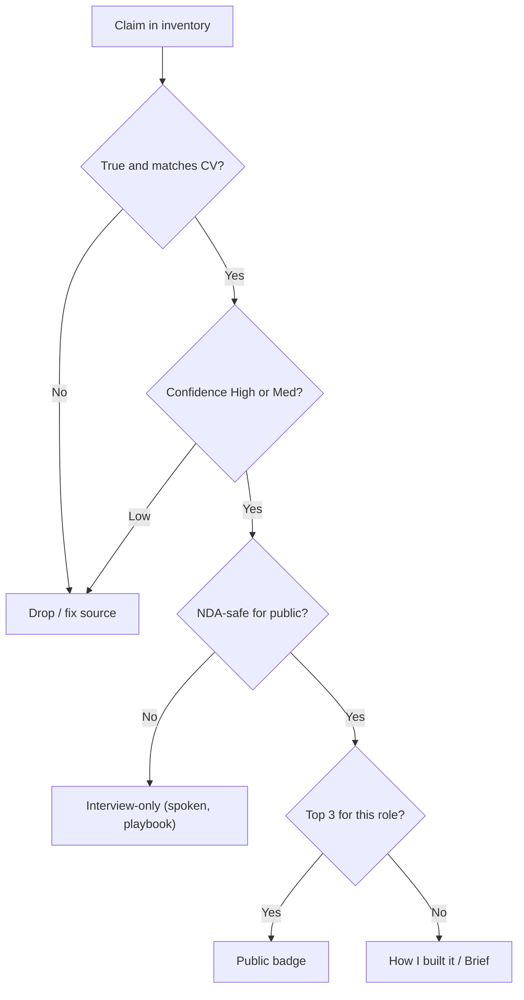
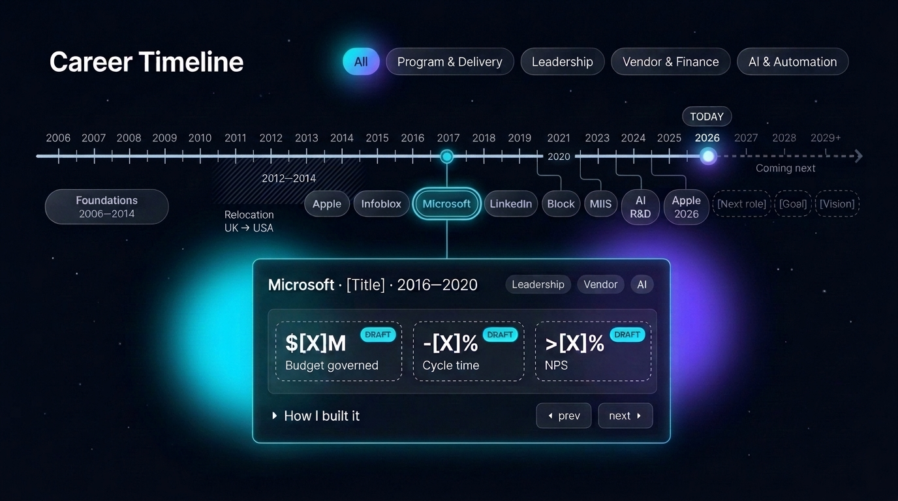
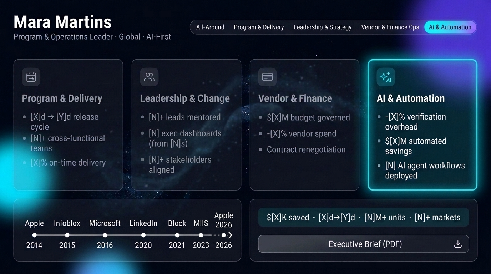
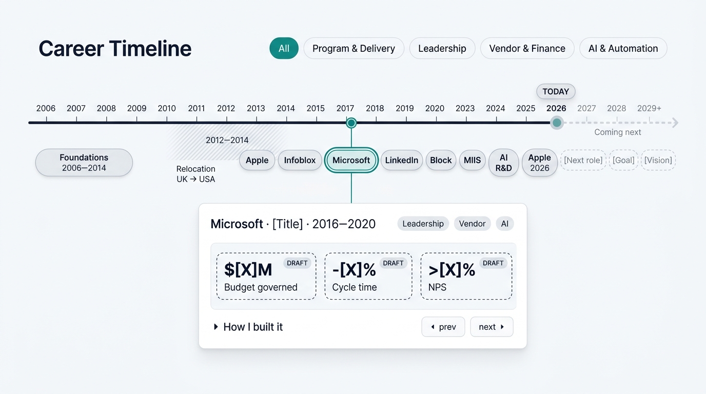
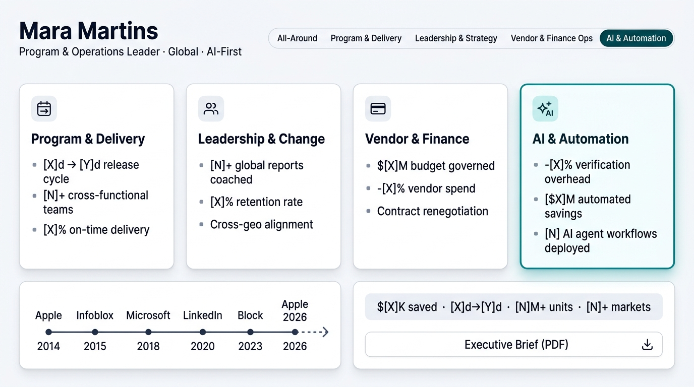
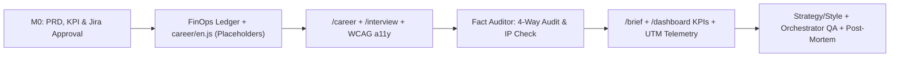

# Technical Design Doc: `maramartins.com` Universal Portfolio Subpages

> [!NOTE]
> **Companion Document:** This is the **Technical Design Doc (How)** paired with the **Project Plan & PRD (What, Why, Business Case, Metrics, Timeline & Risks)**: [project_plan_prd.md](./project_plan_prd.md).

## Goal
Rework the existing React site in `portfolio-builder/frontend` so it works for any Senior/Staff role in Program Management, Operations, AI Enablement or Localization—without altering the existing homepage. The new subpages are organized around **4 pillars**:
1. Program & Delivery
2. Leadership & Change
3. Vendor & Financial Governance
4. AI-First Operations

The work has three parts:
- **Career timeline:** shows 3 metric badges per role and can be filtered by pillar.
- **Interview Mode:** a one-screen grid that doesn't scroll. You keep it open during interviews and use buttons at the top to choose which pillar to highlight.
- **Executive Brief:** a 1-page summary designed for printing, which the interviewer can save as a PDF.

Phase 1 is **English only**. Portuguese is a later phase, but the code will be set up so translations can be added without restructuring.

### What the code looks like today
| Area | Today |
|---|---|
| Stack | React 19, Create React App with craco, Tailwind, Radix/shadcn UI components, react-router v7. Hosted on Vercel, which serves every URL through the React app, so new routes need no Vercel changes |
| Routes | [App.js](file:///Users/user/Documents/github/portfolio-builder/frontend/src/App.js): `/`, `/resume`, `/project/:id`, `/dashboard`, `/gtm`, `/scrum-board`, … |
| Homepage | Hero → Companies → Services → Portfolio → Testimonials → Contact ([HomePage.jsx](file:///Users/user/Documents/github/portfolio-builder/frontend/src/pages/HomePage.jsx)) |
| Content | [data/site/en.js](file:///Users/user/Documents/github/portfolio-builder/frontend/src/data/site/en.js) (title is "AI Localization Strategist & Program Leader"), [data/resume/en.js](file:///Users/user/Documents/github/portfolio-builder/frontend/src/data/resume/en.js) plus PT versions |
| Translations | i18next with `locales/en-US.json` and `pt-PT.json`. Pages switch data files based on `i18n.language` |

---

## User Review Required

> [!WARNING]
> **The plan's career data doesn't match `data/resume/en.js`.** I need to know which version is correct before I build anything:
>
> | Item | Plan says | Site today says |
> |---|---|---|
> | Apple (via Mindsource/WPP) May–Sep 2026 | Senior PgM / Producer | **missing** |
> | Jul 2025 – May 2026 | AI & Python Ops R&D | "Career Transition / Open to New Opportunities" |
> | MIIS title | Program Management Professor | Visiting Professor |
> | Block title | Senior Manager | Program Management Lead – Localization |
> | LinkedIn title | Senior Manager, Product Ops | Senior Marketing Manager – Localization |
> | Microsoft end date | Apr 2020 | Mar 2020 |
> | Years of experience | 12+ | 15+ |
>
> My recommendation: use your **current CV** as the single source of truth. I'd update `resume/en.js` to match it so `/resume`, the timeline, Interview Mode and the Brief all show the same facts.

> [!IMPORTANT]
> **All metrics must be ones you can back up in an interview** (for example $700K cost avoidance, 14d → 4d, 25M+ units). I'll copy them exactly from the plan. Please tell me about any you want to soften, or any that NDAs prevent you from naming publicly (Apple 2026 especially).

## Decision (round 4): keep everything on separate subpages and leave the current site untouched
- **No changes to the homepage or any existing page.** The timeline will **not** be added to `HomePage.jsx`.
- New, self-contained subpages:
  - **`/career`**: the full interactive Career Timeline, with pillar filters, the metrics panel and future placeholders.
  - **`/interview`**: the one-screen Interview Mode (unlisted, `noindex`).
  - **`/brief`**: the printable Executive Brief.
- **The only change to existing code:** registering 3 routes in `App.js`. If you want, a "Career" link can be added to the header or footer later, as a single-line change.
- **Styling:** the current site uses a dark "stellar" look (`stellar-bg`, violet and cyan glows, white bold type, glass cards). The new pages will **use that same brand look** (dark background, cyan/violet accents, glass cards), so they read as part of the same site rather than the light style in the mockups. The layout and interactions from the mockups stay the same.
- **Advantages:** no risk to the live homepage, each page can be built and reviewed on its own, and removing the feature means deleting 3 routes.

## Step 0 (must be done before any code): consistency check
All timeline dates and titles come from **your CV**. The comparison against LinkedIn, the site and the Middlebury bio is tracked in [consistency_audit.md](./consistency_audit.md). Anything that doesn't match goes on that file's update list for each app.

## Decisions So Far (round 2)
- **Your CV is the source of truth.** No facts or dates change until you send proof of the exact timeline. Until then, **the site shows placeholder data** (see §0).
- **LinkedIn consistency check:** I can't open linkedin.com/in/maramartinspt, because LinkedIn requires a login. Public sources (your Middlebury faculty bio and Xing) already conflict with the CV and the site:

  | Source | Claim | Conflicts with |
  |---|---|---|
  | Middlebury bio | "14+ years" | Site: 15+ / Plan: 12+ |
  | Middlebury bio | Microsoft "Program Manager, MS Store E-commerce, 200+ products, 195 languages, $2M+" | Site: "Sr. Global Marcom Manager", 40+ markets |
  | Middlebury bio | LinkedIn & Square: "Manager" | Plan: "Senior Manager" |

  **Next step:** on LinkedIn, go to your profile → **More → Save to PDF**, and drop the file into `docs/source/`. Do the same with your CV. I'll then fill in a **4-way comparison table: CV ↔ LinkedIn ↔ site ↔ Middlebury bio**, saved as `docs/CONSISTENCY_AUDIT.md`, which you'll use to decide what to fix where.

---

### 0. Placeholder data (first draft before publishing)
Every placeholder has the **same shape** as the real data, so swapping in real data later means editing values only, not layout. Each one is **specific to its role**, and each is clearly marked so nothing fake can reach production by mistake:
```js
{ value: '[$X]M', label: 'Budget governed', kind: 'scale',   placeholder: true, hint: 'CV: Microsoft budget' }
```
- **Rule of 3 for every role:** **Scale** ($ / markets / units) · **Velocity** (% or before→after) · **Quality/Governance** (SLA, compliance, NPS).
- `placeholder: true` shows a dashed outline and a "DRAFT" tag on the page. A test, plus a check during `yarn build`, **fails the production build if any placeholder is left**, so a draft can't be published by accident.
- `hint` records where the real number should come from (the CV line or STAR story).

| Role | Scale | Velocity | Quality / Governance | Role-specific focus |
|---|---|---|---|---|
| Apple 2026 | `[N]M+ content units` | `-[X]% verification overhead` | `[N] countries · [X]% compliance` | GenAI + HITL automation |
| AI & Python R&D | `[N] tools/pipelines built` | `[X] hrs saved / eval run` | `LLM-as-judge eval: [X]% agreement` | Technical upskilling |
| MIIS | `[N]+ students mentored` | `[N] courses designed` | `[N] industry partners` | Teaching & thought leadership |
| Block | `[N] markets · [N] regions` | `[X]d → [Y]d release cycle` | `[N] exec dashboards (from [N]s)` | Vendor consolidation |
| LinkedIn | `[N] languages` | `+[X]% delivery consistency` | `[X]% pre-freeze validation` | Eng partnership |
| Microsoft | `$[X]M budget · [N]+ markets` | `-[X]% cycle time` | `>[X]% NPS · $[X]K cost avoided` | CoE & vendor MSAs |
| Early career | `$[X]K budget` | `[N] hrs DAM migration` | `[N]M term DB` | Foundations |

---

### 2b. Career timeline: interactive design proposal
> [!NOTE]
> **Inspiration:** [Alliance Interactive: best website timeline examples](https://www.allianceinteractive.com/blog/best-website-timeline-examples-and-design-tips/). I couldn't load the page directly; this is based on a web search summary of it. How each of its tips is applied here:
>
> | Article tip | How it's applied |
> |---|---|
> | Horizontal works best for 8+ milestones | You have 15+ entries → **horizontal rail** (option A), with early years collapsed into one group |
> | Keep the path obvious (connecting line, markers, clear dates) | Continuous rail with a tick for every year, a different marker shape for each entry type, and a **TODAY** marker |
> | Small interactions: hover effects, click for more detail | Hover → a dot grows and shows a tooltip (company · years). Click → a **metrics panel** with count-up badges |
> | Visuals over walls of text | Company logo on each card, 3 **metric badges** instead of bullet points, and the "How I built it" text hidden until clicked |
> | Concise copy, with "Read more" | 1 summary line per role; the 2 highlight bullets are collapsible; a link goes to the full `/resume` |
> | Falls back to vertical on mobile | Under 768px → vertical list with tap-to-expand cards |
> | Easy to add entries later | A single data file (`career/en.js`), so a new role, milestone or future goal is one object added to it |
>
> **Optional additions (P2), based on the article:** era colors (Foundations · Big Tech · Leadership · AI) and a "play" button that steps through your career automatically, about 3 seconds per role.

**Recommended layout: horizontal year rail and company chips, with a detail panel below that changes when you click.**
```
 2007 ──●── 2010 ──●── 2014 ──●── 2016 ────●──── 2020 ──●── 2021 ──●── 2023 ──●── 2025 ──●── 2026
      Sony   Hogarth  Apple  Infoblox  Microsoft  LinkedIn  Block   MIIS    AI R&D   Apple
                                          ▲ selected
┌──────────────────────────────────────────────────────────────────────────────┐
│ Microsoft · Sr. Global Marcom Manager · 2016–2020   [Leadership][Vendor][AI] │
│  ┌─────────┐ ┌─────────┐ ┌─────────┐   ← 3 metric badges count up on open    │
│  │ $[X]M   │ │ -[X]%   │ │ >[X]%   │                                          │
│  └─────────┘ └─────────┘ └─────────┘                                          │
│  ▸ How I built it (2 bullets)                       ◂ prev   next ▸          │
└──────────────────────────────────────────────────────────────────────────────┘
```
- **Click a company or year:** the panel below slides in with that role's 3 metrics, which count up as they appear, plus its pillar tags.
- **Pillar filter:** lights up only the matching dots on the rail. In Interview Mode, the `?lens=` setting does the same thing.
- **Size of each segment** on the rail reflects how long you were in that role, so a 4-year role takes up more space than 1 year.
- **Keyboard:** ← → move between roles; the URL updates (`/#timeline/microsoft`) so you can link straight to a role.
- **Mobile:** the rail becomes a vertical list, and each card expands in place when tapped.
- **Built from:** Tailwind, the Radix `Tabs` component (for keyboard support and accessibility) and CSS transitions. **No new dependencies.** If you want smoother motion, `framer-motion` could be added later as an optional upgrade.
- The **same component** appears on the homepage (full size) and in `/interview` (compact, without the "How I built it" section).

Other options, if the inspiration link points to a different style:

| Style | Pros | Cons |
|---|---|---|
| A. Horizontal rail + detail panel (above) | Quick to scan; you can glance at it during interviews | Gets crowded with 10+ roles, so early-career roles are grouped together |
| B. Vertical scroll timeline | Familiar; works naturally on mobile | Needs scrolling, which doesn't suit the no-scroll Interview Mode |
| C. Grid of company logos that open a modal | Very visual | Doesn't show your career progression as clearly |

---

---

### 2c. Full timeline: graduation → today → future (round 3)
The year rail covers **every year from graduation to 2026 with no gaps**, then continues as a **dashed "future" section**.

```
 2005  2006  2007 ... 2010 2011 2012 2013 2014 2015 2016 ... 2020 2021 2022 2023 2024 2025 2026 ┆ 2027  2028  2029+
  🎓    RTP   Sony     Hogarth  ░ UK→USA ░  Apple Infoblox Microsoft  LinkedIn Block  MIIS   AI R&D Apple┆ [Next] [Goal] [Vision]
        EU                                                                                    TODAY ▲ ┆  dashed / ghost
```

**Year-by-year content.** Dates come from the CV, which is the source of truth; until you confirm them, the site's `resume/en.js` is used as a temporary draft.

| Years | Entry | Type |
|---|---|---|
| `[YYYY]` | 🎓 Graduation: `[Degree, University]` | milestone (**need from you**) |
| 2006 | RTP internship · EU DG Translation traineeship | role |
| 2007 | Sony Portugal → Sony UK (2007–2010) | role |
| 2010–2012 | Hogarth Worldwide (Account Mgr → Senior) | role, shows a promotion |
| 2012–2014 | UK → USA relocation | **career break**: shown as a lighter "life event" segment, not hidden |
| 2014–2015 | Apple (Localization PM) | role |
| 2015–2016 | Infoblox (via Acclaro) | role |
| 2016–2020 | Microsoft | role |
| 2020–2021 | LinkedIn | role |
| 2021–2022 | Block | role |
| 2023–2025 | MIIS | role |
| 2025–2026 | AI & Python Ops R&D | role / learning |
| 2026 | Apple (via Mindsource/WPP) | role, then a **TODAY** marker |
| 2027 | `[Next role: Senior/Staff PgM · Ops · AI Enablement]` | **future placeholder** |
| 2028 | `[Goal: e.g., lead org-wide AI operations program]` | **future placeholder** |
| 2029+ | `[Vision: e.g., Director / Head of Global Operations]` | **future placeholder** |

**How each type of entry looks:**
- **Role:** solid dot. Clicking it shows 3 metric badges (placeholders for now, as in §0).
- **Milestone** (graduation, certifications, talks, promotions): a small diamond. Clicking it shows a one-line description, with no metrics.
- **Career break:** a lighter, striped segment with a short, positive label (for example "Relocation UK → USA").
- **Future:** a dashed outline in a muted color, marked "Coming next". Clicking it shows the goal and the skills you're building toward it. These can be **hidden with one setting (`showFuture`)** for formal interviews or the public site.
- **Gaps between years** don't break the rail. Every year has a tick mark, so the timeline reads as continuous.

**Grouping so it doesn't get crowded:** 2006–2014 is collapsed by default into one "Foundations" group; clicking it expands to show each role. 2014 onward is always expanded. In Interview Mode the rail shows only 2014 onward plus the future section.

**Data shape** (added to `career/en.js`):
```js
{ id: 'grad', type: 'milestone', year: '[YYYY]', title: '[Degree]', org: '[University]', placeholder: true }
{ id: 'relocation', type: 'break', start: '2012-01', end: '2014-10', title: 'Relocation UK → USA' }
{ id: 'future-1', type: 'future', year: 2027, title: '[Next role]', skills: ['[...]'], placeholder: true }
```

## Open Questions

1. **How should Interview Mode be reached? (you asked me to recommend one)**

   | Option | Pros | Cons |
   |---|---|---|
   | **A. Separate route `/interview` (recommended)** | Its own full-screen layout with no header or footer, so it fits on one screen more easily. Easy to bookmark. Can be kept out of search results. Doesn't affect the public homepage | Visitors won't find it unless you link to it |
   | B. Toggle on the main site | Visitors can find it | Has to fit around the header, footer and video bubble. Makes the homepage code more complex |
   | C. Both | Both benefits | Most work |

   **Recommendation: A, plus a small "Interview view" link in the footer.** You'd add a `?lens=ai` parameter to the URL to pre-select a pillar before a call.
2. **Headline (still open).** My recommendation: **show your name, plus a short line that changes with the selected pillar**, rather than no subtitle at all. With only a name, recruiters have to work out what you do; the subtitle tells them in about 3 seconds.
   - Default: **"Mara Martins: Program & Operations Leader · Global · AI-First"** (works for any of your target roles).
   - With `?lens=` selected, the line changes: AI → "AI Enablement & Operations Leader", program → "Senior Technical Program Manager", and so on. That gives you one site with a headline tailored to each application.
   - All of these lines live in one data file, so changing them later is a 1-line edit.
3. **Existing homepage sections:** should the timeline **replace** Services, or be added **between Portfolio and Testimonials** and leave Services as it is? I recommend adding it and rewording the Services cards around the 4 pillars.
4. **Should `/interview` and `/brief` be blocked from search engines** (`noindex`)? I recommend yes for `/interview` and no for `/brief`.

---

## Proposed Changes

### 1. One data file that every view reads from

#### [NEW] `src/data/career/en.js`
Every view reads from this file: the timeline, Interview Mode, the Brief and the pillar cards. That keeps the metrics identical everywhere.
```js
export const pillars = [
  { id: 'program',    label: 'Program & Delivery',   icon: 'Target',    proof: [...] },
  { id: 'leadership', label: 'Leadership & Change',  icon: 'Users',     proof: [...] },
  { id: 'vendor',     label: 'Vendor & Finance Ops', icon: 'Wallet',    proof: [...] },
  { id: 'ai',         label: 'AI & Automation',      icon: 'Cpu',       proof: [...] },
];
export const roles = [
  {
    id: 'block', company: 'Block, Inc. (Square & Cash App)', title: '…', period: 'Nov 2021 – Nov 2022',
    pillars: ['program', 'vendor', 'leadership'],
    metrics: [ { value: '-30%', label: 'Spend & Turnaround', kind: 'efficiency' },
               { value: '14d → 4d', label: 'Release Cycle', kind: 'velocity' },
               { value: '5', label: 'Exec Dashboards (from 100s)', kind: 'governance' } ],
    highlights: ['…', '…'],
  },
  // apple-2026, ai-rnd, miis, linkedin, microsoft, early-career
];
export const beforeAfter = { program: {before:[...], after:[...]}, ... }; // modal diagrams
```
#### [NEW] `src/data/career/index.js`
Provides a `useCareerData()` hook that picks the data file for the current language. Until Portuguese is added it always returns the English data, so adding `career/pt.js` later is all the Portuguese phase needs.

#### [MODIFY] `src/data/resume/en.js`
Update it to match the facts you confirm (see the warning above).

---

### 2. Career Timeline Subpage (`/career`)

#### [NEW] `src/pages/CareerPage.jsx`
- Standalone "Stellar" dark-theme page hosting `CareerTimeline` (leaving `HomePage.jsx`, `Header.jsx`, and `data/site/en.js` **100% untouched** for Phase 1–3; optional Header/Footer nav link is deferred to P2).

#### [NEW] `src/components/CareerTimeline.jsx`
- Filter buttons: All · Program & Delivery · Leadership · Vendor & Finance · AI & Automation, built with the Radix `ToggleGroup` component already in the project. Roles that don't match the filter are dimmed rather than hidden.
- Horizontal continuous rail from graduation (`[YYYY]`) through 2026 (`TODAY`) plus dashed future placeholders (`2027`, `2028`, `2029+`), falling back to a vertical list on mobile (`< 768px`).
- Each selected role panel displays company wordmark/monogram (cleared by **IP Counsel**), title, dates, pillar tags, **3 metric badges (Scale, Velocity, Quality)**, and a collapsible "How I built it" section (Radix `Collapsible`).
- Full keyboard support (`Tab`, `←`/`→` across roles) + WCAG 2.1 AA contrast & `aria-labels`.

#### [NEW] `src/components/MetricBadge.jsx`
A small badge with a different accent for each metric type (`scale`, `velocity`, `quality`). Marks `placeholder: true` items with a dashed border + `DRAFT` pill. Shared with `/interview`.

---

### 3. Interview Mode: `/interview`

#### [NEW] `src/pages/InterviewMode.jsx`
The page takes up exactly the screen height (`h-screen`), never scrolls (`overflow-hidden`) and has no header or footer.
```
┌───────────────────────────────────────────────────────────┐
│ Mara Martins · Senior Program & Ops Leader   [lens pills] │
├──────────────┬──────────────┬──────────────┬──────────────┤
│ Program &    │ Leadership & │ Vendor &     │ AI &         │
│ Delivery     │ Change       │ Finance      │ Automation   │
│ 3 proof pts  │ 3 proof pts  │ 3 proof pts  │ 3 proof pts  │
├──────────────┴──────┬───────┴──────────────┴──────────────┤
│ Compact timeline    │ Headline metrics strip              │
│ (logos + 1 metric)  │ $700K · 14d→4d · 25M+ · 40+ mkts    │
└─────────────────────┴─────────────────────────────────────┘
```
- **Lens buttons:** All-Around · Program & Delivery · Leadership & Strategy · Vendor & Finance Ops · AI & Automation. Choosing one dims the cards that don't apply and highlights the ones that do. The choice is saved in the URL (`?lens=`), so you can open the right view before a call.
- **Click a card** to open a modal (Radix `Dialog`) with a **Before → After** diagram. The diagrams are built from Tailwind boxes and arrows, so no internal company screenshots are used.
- Keyboard shortcuts `1`–`5` switch lenses and `Esc` closes the modal, so you can switch quickly while screen-sharing.
- The layout is tuned for 1440×900 and 1920×1080. It uses smaller text on screens shorter than 900px (`text-[clamp(...)]`).
- Hides the `VideoBubble` on this route.

#### [NEW] `src/components/interview/PillarCard.jsx`, `BeforeAfterModal.jsx`, `LensPills.jsx`

#### [MODIFY] `src/App.js`
```diff
+ import CareerPage from './pages/CareerPage';
+ import InterviewMode from './pages/InterviewMode';
+ import ExecutiveBrief from './pages/ExecutiveBrief';
  ...
+ <Route path="/career" element={<CareerPage />} />
+ <Route path="/interview" element={<InterviewMode />} />
+ <Route path="/brief" element={<ExecutiveBrief />} />
- <VideoBubble />
+ {!['/interview','/brief'].includes(pathname) && <VideoBubble />}
```
`noindex` is added from inside `/interview` with a `<meta>` tag, so no new dependency is needed.

---

### 3b. Telemetry, FinOps Ledger & `/dashboard` KPI Reporting

#### [NEW] `docs/content/project_ledger.md` & `src/data/projectMetrics.js`
- Maintained by **FinOps & Token Controller** + Sarah (`jira_pm_agent.py`): logs Mara Martins hours, AI active vs. idle time, tokens spent, token `$` equivalents, and direct SaaS/domain costs (`$21.99/yr` domain + `$14.99/yr` protection).

#### [MODIFY] `src/pages/Dashboard.jsx`
- Adds a **"Portfolio Optimization KPIs"** panel behind the existing `gov_auth_key` gate showing: Cost/Time/Token Burn, Consistency Audit % & Placeholder Count, Agent QA Fleet status + AI runtime/tokens, and UTM-filtered GA4/PostHog funnel signals (**Analytics & Telemetry Engineer**).

---

### 4. Executive Brief: `/brief`

#### [NEW] `src/pages/ExecutiveBrief.jsx`
- A US Letter/A4 page: name and contact details, a 2-line summary, a 4-pillar grid with the top 3 proof points in each, and a compact list of roles with metrics.
- A **"Download PDF"** button that calls `window.print()`.
- Print CSS (`@media print { @page { size: letter; margin: 0.5in } }`) that hides the button and fits everything on one page.
- Linked from Interview Mode, the footer, and `/resume`.

---

### 5. Talking-points guide (not code)

#### [NEW] `docs/INTERVIEW_PLAYBOOK.md`
Covers the "45-second screen-share" technique, translating domain jargon into general operations language, the "Rule of 3 Metrics" (scale, efficiency and quality for each role), and how to keep visuals NDA-safe. It also explains which `?lens=` to use for each interview type.

---

### Out of scope for now
- **P2: More milestones** (certifications, talks, promotions, awards). The timeline already supports milestones (`type: 'milestone'`), so adding these later only means adding data. You'll provide the list.
- Portuguese translations (the data layer is ready for them).
- Light/dark theme, and changes to the backend or EmailJS.

---

## Content Data Plan: gathering, structuring and choosing what to include

### A. Gather: where content comes from, ranked by how much to trust it
| Rank | Source | Used for | Where to put it |
|---|---|---|---|
| 1 | **CV** (the source of truth) | Titles, dates, scope | `docs/source/CV.pdf` |
| 2 | **Evidence:** performance reviews, promo letters, offer letters, exec decks or emails *with numbers* (keep these private) | Proof for metrics | `docs/source/evidence/` (**gitignored**, so never published) |
| 3 | **STAR stories** (Interviews workspace) | "How I built it" text, before→after diagrams | `docs/source/star/` |
| 4 | **LinkedIn PDF**, Middlebury bio, Xing | Consistency check only | `docs/source/` |
| 5 | Recommendations, testimonials, public talks/articles | Testimonials, P2 milestones | `docs/source/public/` |

> [!CAUTION]
> `docs/source/evidence/` will be added to `.gitignore` **before** you add any files. Your repo may be public (it's linked from your site), so confidential documents must never be committed to it.

### B. Organize: one place to collect each fact
**`docs/content/career_inventory.md`** is a table you and I fill in together. **Every claim gets one row:**

| id | role | pillar | metric type | claim (draft) | number | evidence (file / reference) | confidence | NDA risk | public? | interview-only? |
|---|---|---|---|---|---|---|---|---|---|---|
| ms-01 | Microsoft | vendor | scale | Cost avoidance on budget | $700K / $2M | review-2019.pdf p2 | High | Low | ✅ | |
| ap26-02 | Apple 2026 | ai | velocity | Verification overhead cut | -30% | STAR #4 | Med | **High** | ❌ | ✅ |

Rows that pass the checks in step C are turned into `career/en.js` for the site.

### C. Decide: what goes in and what stays out
Every claim has to pass **all 5 checks** before it goes on the public site:

| # | Check | Pass when |
|---|---|---|
| 1 | **True & matches the CV** | It appears in or follows directly from the CV. If dates or titles disagree, the CV wins and the other source goes on the update list |
| 2 | **Provable** | You could explain where the number came from in 30 seconds. Confidence **High** = documented; **Med** = your own estimate you can defend (shown with "~" or "approx."); **Low** = left out |
| 3 | **NDA-safe** | No confidential product names, unreleased projects, internal tool names or client data. Numbers are aggregated or rounded ("25M+", "40+ markets"). If unsure → **interview-only** |
| 4 | **Useful for any role** | It supports at least one of the 4 pillars and makes sense to someone outside localization (no unexplained jargon) |
| 5 | **Adds something new** | It isn't just repeating a metric already shown. Each role gets **one** scale, **one** velocity and **one** quality metric (Rule of 3); anything extra goes in "How I built it" or the playbook |

**Where each item ends up:**


**Also left out of the public site:** salary or compensation, names of people you managed, specific internal tools or code names, opinions about former employers, and early-career detail before 2014 beyond a single line per role, which stays inside "Foundations".

**Who sees what:**
| Level | Shown on | Examples |
|---|---|---|
| Public | Homepage timeline, `/brief` | Rounded metrics, pillar tags |
| Unlisted | `/interview` | Slightly more detail, before→after diagrams |
| Spoken only | Playbook (never on the site) | NDA-sensitive specifics, exact numbers |

### D. Make it available to the site
1. `career_inventory.md` (the working draft) → I convert the approved rows into `src/data/career/en.js`.
2. A test checks that every role has exactly 3 metrics, that no placeholder is left in a production build, and that every metric has an `evidenceId` pointing back to its inventory row.
3. When the data changes, the timeline, Interview Mode and the Brief all update together, because they read from one file.

### E. Steps and who does what
| Step | You | Me |
|---|---|---|
| 1 | Put the CV and LinkedIn PDF in `docs/source/` | Set up the folders + `.gitignore`, finish the consistency check |
| 2 | Add evidence/STAR files whenever you can | Pre-fill the inventory from the CV and STAR stories, marking confidence and NDA risk |
| 3 | Review the inventory: mark each row public, interview-only or drop | Apply the 5 checks and point out problem rows |
| 4 | Sign off the final top-3 metrics for each role | Generate `career/en.js` and swap out the placeholders |

## Build Order

### Phase 0: Mockups (done, ready for your review)
**v2: matches your site's look (dark "stellar" style), for `/career` and `/interview`:**
````carousel

<!-- slide -->

````
> [!NOTE]
> The v2 Interview Mode mockup is correct. The v2 timeline mockup still has a mistake from the image generator: the rail squeezes 2020–2022 together. In the real build, every year gets an equal tick.

**v1 (light, replaced by v2):**
````carousel

<!-- slide -->

````
> [!NOTE]
> These are AI-generated drafts of the design, so they contain mistakes that **the real build will fix**:
> - The timeline rail skips 2021–2022.
> - The mini-timeline in Interview Mode has wrong years (Microsoft 2018, Block 2023) and is missing MIIS.
> - In Interview Mode, the cards that don't match the selected lens should be dimmed more.
> - The proof points in the Leadership card ("retention rate") were invented by the image generator. They'll be replaced with your placeholders.

### Phase 1: MVP proof of concept (`feature/portfolio-mvp`, ON HOLD until Mara Martins approves PRD & Jira steps)
- **What's in it:**
  - `src/data/career/en.js` with **role-specific placeholder data** + `evidenceId` fields + `placeholder` production build guard (Sofia / `career.test.js`).
  - Standalone `/career` page (`CareerTimeline` + `MetricBadge`, continuous graduation → today → future rail) using stylized text/monogram company chips until **IP Counsel** clears logos.
  - Standalone `/interview` page (`InterviewMode` zero-scroll 4-pillar bento, `?lens=`, `1–5`/`Esc` keyboard navigation, `noindex`).
  - **Lightweight Resource & Schedule Board in `/dashboard` (~30 min):** JSON-backed (`src/data/resourceUtilization.json` + `docs/content/project_ledger.md`) showing planned schedules, capacity caps (`🟢/🟡/🔴`), and actuals updated at every session checkpoint by **FinOps & Focus Guardian**.
  - **WCAG 2.1 AA pass:** Contrast & keyboard focus check on dark glass cards (`WCAG a11y Auditor`).
- **What's left out of Phase 1:** `/brief`, real CV numbers, full GA4/PostHog/token-cost scorecard automation in `/dashboard`, Strategy/Style audit, and P2 items (`REQ-12`–`REQ-14`).
- **Where it's built:** Separate git branch `feature/portfolio-mvp`, previewed locally or via unlisted Vercel preview URL. **Nothing changes on `maramartins.com` (`main`).**

### Phase 2: Content, Consistency & IP Clearance
- **Fact & Evidence Auditor + Marcus:** Gitignore `docs/source/evidence/`, ingest `CV.pdf` & `LinkedIn.pdf`, complete 4-way `consistency_audit.md` + accurate 2007+ tenure math, populate `career_inventory.md`, and swap placeholders in `career/en.js`.
- **IP Counsel:** Clear employer logos or lock monogram/wordmark styling.

### Phase 3: `/brief`, `/dashboard` Telemetry, QA Sweep & Launch
- **Build `/brief`:** Printable 1-pager (`window.print()` `@media print` CSS).
- **Analytics & FinOps Integration:** Wire UTM tracking + GA4/PostHog events (`Analytics & Telemetry Engineer`) and add the **"Portfolio Optimization KPIs"** scorecard panel (cash, hours, AI work/idle, tokens/$$, consistency %, QA status, funnel) to [Dashboard.jsx](file:///Users/user/Documents/github/portfolio-builder/frontend/src/pages/Dashboard.jsx).
- **Strategy & Style Review:** Run `Strategy Advisor` + `Style Guide Agent` + `Isabella` tone/glossary audit on copy and `docs/INTERVIEW_PLAYBOOK.md`.
- **Pre-Close Agent Review & Post-Mortem:** Run `orchestrator.py` (Sofia, Isabella, Marcus, Lucas, Visual Auditor, WCAG a11y), trigger Antigravity's pre-close team review & metrics revision with Mara Martins, and record learnings in `docs/reflections.md`.



## Verification Plan

### Automated
- `cd frontend && yarn build`: must build with no errors.
- **Placeholder Production Guard (Sofia / `lqc_engine.py`):** a `prebuild` / test check ensures zero `placeholder: true` entries ship to `main` production (allowed only on `feature/portfolio-mvp`).
- `yarn test --watchAll=false`: `career.test.js` (**Fact & Evidence Auditor** check) verifies every role has exactly 3 metrics, every `evidenceId` resolves, 2007+ date continuity has zero gaps, and every pillar ID is valid.

### Security, Privacy, IP & Accessibility Checks
- **Git & Secrets (Marcus):** Verify `docs/source/evidence/` is in `.gitignore` *before* any confidential file is placed on disk.
- **SEO / Privacy (Elena):** Verify `<meta name="robots" content="noindex, nofollow">` on `/interview` and verify `/privacy` GDPR disclosures cover new UTM/GA4/PostHog events.
- **IP Fair-Use (IP Counsel):** Verify company logos/wordmarks on `/career` and `/interview` comply with brand/fair-use rules.
- **Accessibility & Contrast (WCAG 2.1 AA Auditor):** Verify dark-theme text contrast (≥ 4.5:1 on glass cards), focus rings on timeline chips, `aria-labels`, and full keyboard navigation (`Tab`, `←`/`→` on `/career`, `1`–`5` & `Esc` on `/interview`).
- **Performance:** Verify no new heavy npm packages added (`0` bundle bloat) and `/career` + `/interview` load under 1.5s locally.

### Alternatives Considered & Rollback Strategy
| Alternative | Why Rejected |
|---|---|
| Full homepage redesign | High risk to live site; breaks existing messaging & layout; slow to ship. |
| WordPress migration (per repo guide) | Unnecessary overhead; React/Tailwind/Radix stack already supports interactive bento/timeline UIs cleanly. |
| Notion / Static PDF only | Not interactive; lacks role-lens filtering and live analytics. |

- **Rollback Plan:** Because the homepage and backend are untouched, rollback is instant via **Vercel Instant Rollback** to the prior deployment, or by removing the 3 routes in `App.js`.

### Browser checks (local `yarn start` — Lucas / `browser`)
- `/interview` at **1440×900 and 1920×1080**: no scrollbar (`document.documentElement.scrollHeight <= innerHeight`). Lens buttons, `?lens=` URL parameter, keyboard shortcuts `1–5`/`Esc`, and modals all work.
- `/career`: continuous 2006–2026 + future rail renders evenly, filters dim matching roles, highlights expand, and mobile (390px) falls back to a clean vertical layout.
- `/brief`: print preview fits on **one page**.
- `/dashboard`: new "Portfolio Optimization KPIs" panel renders behind existing `gov_auth_key` gate.
- `/`, `/resume` and existing routes remain 100% unchanged. Every metric matches across `/career`, `/interview`, `/brief`, and `/resume`.

### Manual (you)
- Do a practice screen-share of `/interview` on your actual interview setup (Zoom/Meet) and confirm it's readable.
