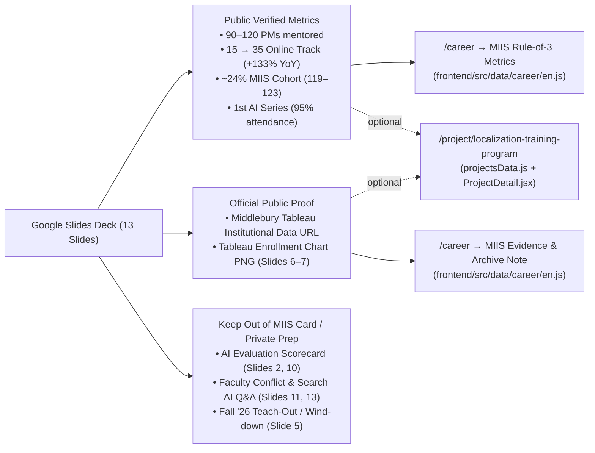

# Implementation Plan: Integrating MIIS Deck Metrics & Evidence into Portfolio

## Goal Description
Leverage verified data, institutional benchmarks, and visual proof from the 13-slide Google Slides deck (**`Mara Martins`**, ID `1qmiDN6Fvu-KuIWHfyv86-J6smzbcjCZvYjf1c4tKLUk`) to replace placeholder `[N]` metrics and strengthen proof of work on the **MIIS (2023–2025)** experience across `/career` (and optionally `/project/localization-training-program`), while keeping confidential/interview-Q&A talking points cleanly separated from public portfolio pages.

### Architecture Overview: Where Each Part of the Deck Fits



---

## User Review Required

> [!IMPORTANT]
> **Metrics Accuracy & Framing (Personal Contribution vs. Institutional Context):**
> - Metrics like **`90–120 PMs mentored`** (`90+` already on `/project/localization-training-program`), **`1st AI Series`** (`95%` attendance), and **`15 → 35` Online Track (+133% YoY)** directly reflect your teaching, speaker series, and online curriculum work.
> - Metrics like **`203` TLM Master's degrees awarded (2023–2025)** and **`~24%` of total MIIS enrollment (`119 → 123` students)** are **official program-level Tableau benchmarks**. They should be labeled clearly as *Program Context* (e.g., *"Flagship TLM + LPRM program (~24% of MIIS)"*) rather than framed as sole personal ownership.
> - **Fall '26 Campus Teach-Out (`207` students)** on Slide 5 should be **omitted** from public cards so the story stays focused on your active `2023–2025` impact.

> [!WARNING]
> **Content Explicitly Excluded per Previous Instruction:**
> - Slides **2, 10, 11, and 13** reference the **AI Evaluation Scorecard** and **Google Search AI Overviews** interview Q&A. Per your earlier note (*"This is not for this role"*), we will **not** add the AI Evaluation Scorecard to the MIIS Career Timeline or MIIS Project Page.
> - Interview defense Q&A slides (**Slides 9–13**) are best kept as private interview prep rather than pasted onto public portfolio pages.

> [!NOTE]
> **Branch Scope (`feature/portfolio-mvp`):**
> Editing [en.js](file:///Users/user/Documents/github/portfolio-builder/frontend/src/data/career/en.js) keeps everything scoped strictly to `/career`. Updating [projectsData.js](file:///Users/user/Documents/github/portfolio-builder/frontend/src/data/projectsData.js) and [ProjectDetail.jsx](file:///Users/user/Documents/github/portfolio-builder/frontend/src/pages/ProjectDetail.jsx) will modify the existing `/project/localization-training-program` page on this feature branch (still separate from `main`).

---

## Open Questions

> [!IMPORTANT]
> Please confirm your preferences on these **4 decisions** before implementation begins:
>
> 1. **Which 3 metrics should replace `[N]+` on the `/career` MIIS card?** (Rule of 3 requires 1 `scale`, 1 `velocity`, 1 `quality`):
>    - **Scale (`scale`):** `90–120` PMs Mentored *(or `90+` to match the existing project page)*?
>    - **Velocity (`velocity`):** `+133%` Online Track Growth (`15 → 35` students, 2024–2025) *(or `1st AI Series`)*?
>    - **Quality (`quality`):** `95%` AI Series Attendance *(or `~24%` MIIS Cohort Share · Flagship Program / `98%` Placement Rate  -  please confirm `98%` is verified before publishing publicly)*?
> 2. **Should we also extract the official Tableau charts from Slides 6–7** into `frontend/public/evidence/` as proof thumbnails inside `How I built it & Evidence Notes` (alongside the public `middlebury.edu/assessment-institutional-research/...` link)?
> 3. **Scope:** Update **only `/career`** (`en.js` + `career.test.js`), **or also enrich `/project/localization-training-program`** (`projectsData.js` + `ProjectDetail.jsx`) with the Institutional Research link and `+133%` Online Track stat?
> 4. **Slide Deck Link:** Should the Google Slides deck remain **private** (used only as our source of truth), or should a clean PDF/link ever be exposed? *(Default recommendation: keep the raw interview Q&A deck private.)*

---

## Proposed Changes

### 1. Career Timeline Dataset & Evidence Links (`/career`)

#### [MODIFY] [en.js](file:///Users/user/Documents/github/portfolio-builder/frontend/src/data/career/en.js)
Replace the three `[N]` placeholder metrics in `miis` (`placeholder: true` → verified values) and append the official Middlebury Institutional Research Tableau URL (plus optional extracted Tableau chart snapshot) to `miis.evidence`:

```js
    metrics: [
      {
        value: '90–120',
        label: 'Graduate TLM & PM leads mentored',
        kind: 'scale',
        placeholder: false,
        hint: 'Source: MIIS Teaching Record (2023–2025) · Flagship cohort (~24% of MIIS)',
        evidenceId: 'mi-01',
      },
      {
        value: '+133%',
        label: 'Online LPRM track growth (15 → 35 students)',
        kind: 'velocity',
        placeholder: false,
        hint: 'Source: Official MIIS Tableau Institutional Enrollment (2024–2025)',
        evidenceId: 'mi-02',
      },
      {
        value: '95%',
        label: 'AI in Localization series attendance',
        kind: 'quality',
        placeholder: false,
        hint: 'Source: First MIIS AI Speaker Series with Block, GitLab, Coupa & Smartling',
        evidenceId: 'mi-03',
      },
    ],
```

Add the official Tableau dashboard source to `miis.evidence.links`:

```js
        {
          label: 'Official MIIS Institutional Data (Tableau)',
          url: 'https://www.middlebury.edu/assessment-institutional-research/institutional-data/middlebury-institute-international-studies',
          kind: 'external',
        },
```

---

### 2. Extracted Chart Assets (Optional  -  Pending Question #2)

#### [NEW] `frontend/public/evidence/miis-enrollment-chart.png` *(if approved)*
Extract verified institutional enrollment chart image(s) from Slide 6/7 via `gslides readonly extract-images 1qmiDN6Fvu-KuIWHfyv86-J6smzbcjCZvYjf1c4tKLUk` into scratch first, inspect visually to confirm zero confidential overlays, and move approved chart(s) into `frontend/public/evidence/`.

---

### 3. Live MIIS Case Study Sync (Optional  -  Pending Question #3)

#### [MODIFY] [projectsData.js](file:///Users/user/Documents/github/portfolio-builder/frontend/src/data/projectsData.js)
Optionally align `'localization-training-program'` (`results` & `credentialBlock`):
- Add **Online Track Growth (`+133%`)** and **Flagship Program Share (`~24%`)** or link the Middlebury Institutional Research URL alongside the faculty profile and Wayback archive in `credentialBlock`.
- Keep both English and `locales.pt` entries in sync.

---

### 4. Automated Test Coverage

#### [MODIFY] [career.test.js](file:///Users/user/Documents/github/portfolio-builder/frontend/src/data/career/career.test.js)
- Assert `miis.metrics` have `placeholder: false` and match the approved verified values (`90–120` / `90+`, `+133%`, `95%` or chosen metric).
- Assert `miis.evidence.links` includes the official `middlebury.edu/assessment-institutional-research/...` source URL.

---

## Verification Plan

### Automated Tests
1. Run the Career Timeline test suite in `frontend/`:
   ```bash
   npm --prefix /Users/user/Documents/github/portfolio-builder/frontend test -- --watchAll=false src/data/career/career.test.js
   ```
2. Verify all asset paths referenced in `en.js` (`logo`, any added `snapshotImage`) resolve on disk inside `frontend/public/`.

### Manual Verification
1. Open `http://localhost:3000/career` (Hard Refresh `Cmd + Shift + R`), select **MIIS**, and confirm:
   - The `2023–2025` rail years highlight in cyan.
   - All 3 Impact Snapshot badges render cleanly without `[Placeholder]` styling.
   - Expanding **How I built it & Evidence Notes** shows the clickable `Official MIIS Institutional Data (Tableau)` link and any approved snapshot image.
2. *(If Question #3 is approved)* Visit `http://localhost:3000/project/localization-training-program` and verify stats and Portuguese (`pt`) locale toggle render cleanly.
