# Project Plan & PRD: `maramartins.com` Portfolio Optimization (Universal Executive Edition)

| Field | Detail |
|---|---|
| **Project Name** | Portfolio Optimization  -  Universal Executive Showcase |
| **Project Key / Sprint** | `PJM`  -  **Portfolio Optimization Sprint** *(Note: logically functions as Sprint 0/1 of this new Portfolio Optimization initiative; follows Sprint 3 in `docs/project_status.json`. Exact Jira Sprint/Epic structure to be reviewed step-by-step with Mara Martins before any tickets are created.)* |
| **Owner / Product Lead** | **Mara Martins** (CEO / Founder per `MARA_MARTINS_OS.md`) |
| **AI Program & Eng Lead** | **Antigravity** (AI Advisor & Agent Manager) |
| **Named Agent Team** | **IDE Subagents:** `image-generator`, `research`, `browser`, `self` (Dev Agent) **Existing Repo Fleet (`agents/*.py` & `/dashboard`):** Sarah (`jira_pm_agent.py`), Orchestrator (`orchestrator.py`), Marcus (`security_analyst.py`), Elena (`loc_lead_expert.py` / Compliance), Sofia (`lqc_engine.py`), Isabella (`lqa_engine.py`), David (`linguist_en_us.py`), Tiago (`linguist_pt_pt.py`  -  P2), Lucas (`tester_agent.py`), Visual Auditor (`visual_auditor.py`), Julia (`gtm_strategy_agent.py`) **Activated (`MARA_MARTINS_OS.md`):** IP Counsel (`ip-counsel`), Strategy Advisor (`strategy-advisor`), Style Guide Agent (`style-guide`) *(General Counsel / Contract Advisor on-call if NDA escalation arises)* **New Agents Needed (Gap Closure):** **FinOps & Token Controller** (`finops-controller`), **Fact & Evidence Auditor** (`fact-auditor`), **WCAG 2.1 AA Accessibility Auditor** (`wcag-auditor`), **Analytics & Telemetry Engineer** (`telemetry-eng`), **KPI & Metrics Steward** (`kpi-steward`), **Delivery & Focus Guardian** (`focus-guardian`) |
| **Status** | **Human Review & Approval Required  -  ON HOLD** *(No code changes and no Jira tickets will be created until Mara Martins approves)* |
| **Pacing Strategy** | **Parallel Build + Prep-Priority Override:** Aim for Nov 23 readiness (AI team builds asynchronously with placeholders while Mara Martins preps); pause/shift focus to interview prep anytime without penalty |
| **Target Anchor Date** | **First Interview: November 23, 2026** *(Flexible  -  Overflow moves cleanly to Post-Nov 23 if prep needs priority)* |
| **Last Updated** | 2026-11-12 |
| **Companion Docs** | Technical Design Doc: [implementation_plan.md](file:///Users/user/.gemini/antigravity/brain/a8ecca47-ef7c-44f0-a7c3-c24545ec0324/implementation_plan.md) · Resource Utilization Board: [resource_utilization_board.md](file:///Users/user/.gemini/antigravity/brain/a8ecca47-ef7c-44f0-a7c3-c24545ec0324/resource_utilization_board.md) |

---

## 1. Executive Summary (TL;DR)
`maramartins.com` currently leads primarily with localization positioning, under-represents Mara Martins's broader technical, operational, and AI program leadership, and lacks a dedicated visual asset built for live interviews. Rather than rebuilding the website (high cost, high schedule risk ahead of **November 23, 2026**), the Human + AI team will add **three standalone, dark-themed ("Stellar") subpages** - `/career` (interactive timeline), `/interview` (zero-scroll live screen-share cockpit), and `/brief` (1-page printable PDF leave-behind) - backed by a **single verified career dataset** anchored to the CV.

> *\*Scope & Cost Caveat (Context for Readers):* Incremental infrastructure cash spend is low because hosting and analytics leverage existing sunk commitments (`maramartins.com` domain + protection at **$36.98/yr** plus existing IDE/AI and hosting plans); however, **total real project cost is NOT $0**. Section 4 tracks direct SaaS/domain spend, Mara Martins's review/content hours, Antigravity + subagent active vs. idle time, and AI token costs against a bounded pre-interview budget.

---

## 2. Problem Statement, Goals & Non-Goals

### Problem Statement
1. **Positioning Breadth Gap:** The public site faithfully reflects Mara Martins's localization roots, yet needs to **expand** its framing so hiring managers across **Technical Program Management, Operations Leadership, and AI Enablement** immediately recognize transferable executive capabilities without losing authenticity to the localization domain.
2. **Cross-Channel Inconsistency:** Dates, titles, tenure calculations, and scope metrics currently conflict across `maramartins.com`, the Middlebury faculty bio, and earlier planning drafts (e.g., 14+ vs. 15+ vs. 12+ years; Microsoft title/dates).
3. **No Live Interview Cockpit:** During remote interviews (starting **Nov 23, 2026**), there is no single-screen, NDA-safe visual dashboard designed to support a concise live screen-share.

### Goals
- **G1 (Truthful Expansion of Positioning):** Stay 100% grounded in Mara Martins's localization foundation while expanding public framing around 4 universal pillars (*Program & Delivery, Leadership & Change, Vendor & Financial Governance, AI-First Operations*) across standalone subpages.
- **G2 (Single Source of Truth & Accurate Tenure):** Eliminate discrepancies across all editable owned channels (**CV, LinkedIn, `maramartins.com`**, and controllable bios like Calendly/Chatbase) via a formal consistency audit *(legacy read-only pages such as the MIIS bio are logged as `Won't Fix / Non-Blocker`)*. Calculate total experience **accurately from graduation and first post-2007 role (`[Verified Years Since 2007]` per CV dates)** rather than using unverified "15+" estimates.
- **G3 (Nov 23 Interview Readiness):** Deliver a zero-scroll `/interview` bento view (`1440×900` / `1920×1080`) and printable `/brief` PDF leave-behind ahead of the **November 23, 2026** interview.
- **G4 (Zero Disruption & Full Cost/Effort Transparency):** Leave the existing homepage, backend, EmailJS contact form, and active routes untouched while accurately logging all human hours, AI active/idle time, token spend, and real dollar costs.

### Non-Goals (Explicitly Out of Scope for Pre-Nov 23 Release)
- **NG1:** No redesign or rewrite of the current homepage (`HomePage.jsx`) or existing case studies.
- **NG2:** No backend CMS, database migration, or WordPress migration.
- **NG3:** No Portuguese (`pt-PT`) translation in Phase 1 (the `useCareerData()` layer remains i18n-ready; translations deferred to P2).
- **NG4:** No publication of confidential employer metrics or unverified numbers (NDA-sensitive items remain spoken-only).

---

## 3. Target Users & User Journeys

| Persona | Context | Primary Surface | Core Journey |
|---|---|---|---|
| **Recruiter / Sourcer** | Screening link from job application (ideally UTM-tagged) | `/career` or `/brief` | Scans 4 pillars + full career arc from graduation → today → future placeholders in **< 30 sec**. |
| **Hiring Manager** | Pre-interview preparation | `/career` + `/resume` | Filters timeline by target pillar (e.g., AI & Automation), expands 1–2 "How I built it" bullets (**2–3 min**). |
| **Interview Panel** | Live Zoom/Meet call (starting Nov 23) | `/interview?lens=...` | Mara Martins shares screen for ~45 sec; panel views 3 quantified proof points + NDA-safe Before→After diagram without scrolling. |
| **Hiring Committee / Executive Sponsor** | Post-interview calibration | `/brief` (exported PDF) | Receives a 1-page leave-behind with consistent, citable metrics matching the CV. |

---

## 4. Business Acumen: Real Cost Model, Time/Token Tracking & Budget Controls

### Are Cost, Hours & AI Consumption Part of Project Metrics?
**Yes.** In an **executive-standard program**, metrics are split into **Product / Career Outcome Metrics** (did the asset achieve interview goals?) and **Operational / Delivery Efficiency Metrics** (what did the Human + AI team actually consume in cash, hours, and tokens vs. estimate?). Real project cost is **never $0** once domain renewals, tooling subscriptions, human opportunity cost, and AI compute/tokens are accounted for.

### 4.1 Direct Cash & Tooling Costs (Actuals vs. Estimates)

| Cost Category | Item / Provider | Billing / Allocation Basis | Estimated Cost | Actual Spent to Date | Notes |
|---|---|---|---|---|---|
| **Domain Registration** | `maramartins.com` (`.COM Domain Renewal`) | Bills **02/12/2026** · 1-Year Term | **$21.99 / yr** | $21.99 committed (annual) | Existing domain renewal |
| **Domain Privacy / Security** | Full Domain Protection  -  Renewal | Bills **02/12/2026** · 1-Year Term | **$14.99 / yr** | $14.99 committed (annual) | Existing protection renewal |
| **Hosting & Previews** | Vercel | Monthly plan / usage tier | `[TBD: $0 free tier or pro-rated $/mo]` | `[Check Vercel billing]` | Supports branch previews & rollback |
| **Analytics** | GA4 (`G-0BB4XSY59N`) + PostHog | Free / usage tier | `[TBD: $0 within free quota]` | $0 overage to date | Existing integrations in `frontend` |
| **Program Management** | Atlassian Jira (`PJM`) | Free / standard tier | `[TBD: $0 or seat cost]` | $0 incremental | Managed with Sarah (`jira_pm_agent.py`) |
| **IDE & AI Platform** | Antigravity IDE + Model Usage + Image Gen | Subscription / API token allocation | `[TBD: pro-rated $/mo + token eq.]` | *Phase 0 tokens logged below* | Must be tracked explicitly (not "$0") |
| **PDF Generation** | Browser `@media print` CSS | Built-in browser capability | $0 | $0 | Avoids third-party PDF API fees |
| **Direct Annual Domain Subtotal** |  -  |  -  | **$36.98 / yr** *(+ SaaS/AI allocation TBD)* | **$36.98 / yr committed** | Exact SaaS/AI dollar rates to be filled in `project_ledger.md` |

### 4.2 Effort, AI Time (Work vs. Idle) & Token Budget (Estimated vs. Actuals)

> [!IMPORTANT]
> **Tracking Beyond `# Hours`:** Every phase tracks **four dimensions**: (1) **Human Owner Hours** (Mara Martins), (2) **AI Active Execution Time vs. Idle/Wait Time**, (3) **AI Token Usage** (input/output tokens + image-gen calls), and (4) **Dollar Value / Cash Allocation ($)**.

| Phase | Scope & Team Contributors | Est. Mara Hrs | Est. AI Active / Idle Time | Est. AI Tokens / Assets | Actuals to Date (Nov 12, 2026) | Status |
|---|---|---|---|---|---|---|
| **Phase 0: Discovery, PRD & Mockups** | Repo audit, consistency design, 4 mockups (`image-generator`), PRD & Design Doc (`Antigravity`) | ~1.5–2.0 hrs | ~1.0 hr active / ~0.5 hr idle-review | 4 image-gen runs + ~`[TBD]` LLM tokens | **~1.75 hrs Mara · ~1.0 hr AI active · 4 mockups generated** *(exact token count TBD from session log)* | **In Progress (Under Review)** |
| **Phase 1: MVP Build (Placeholders)** | `career/en.js`, `/career`, `/interview`, `/dashboard` FinOps skeleton, a11y & unit tests (`Antigravity`, `self`, `Sofia`, `Lucas`, `Visual Auditor`, `WCAG a11y Auditor`) | ~1.5 hrs (review & step checks) | ~2.5 hrs active / ~0.5 hr wait | ~`[TBD]` LLM tokens | 0 | **ON HOLD (Pending Approval)** |
| **Phase 2: Content, IP & Consistency Audit** | `CV.pdf` + `LinkedIn.pdf` + evidence; 4-way audit; 2007+ math; `career_inventory.md`; logo fair-use check (`Mara Martins`, `Fact & Evidence Auditor`, `research`, `Elena`, `Marcus`, `IP Counsel`, `David`) | ~4.5–6.5 hrs *(incl. 0.5h IP/Style review)* | ~2.75 hrs active / ~0.5 hr wait | ~`[TBD]` LLM tokens | 0 | **Blocked on CV / LinkedIn PDF** |
| **Phase 3: `/brief`, `/dashboard` KPIs & Launch** | Printable `/brief`, KPI & token scorecard in `/dashboard`, UTM telemetry, tone/glossary pass, QA sweep, post-mortem (`Antigravity`, `Analytics Eng`, `KPI Steward`, `Focus Guardian`, `FinOps`, `Strategy/Style`, `Orchestrator`, `Sarah`, `Julia`) | ~2.25 hrs | ~2.75 hrs active / ~0.5 hr wait | ~`[TBD]` LLM tokens | 0 | **Planned** |
| **Total Pre-Nov 23 Budget** | **End-to-End Delivery (incl. All 9 New Roles)** | **~9.75–12.25 hrs** | **~9.25 hrs active / ~2.0 hrs idle** | **`[Baseline TBD]`** | **Phase 0 active** | **ON HOLD** |

### 4.3 How Time, Tokens & Real Costs Will Be Tracked (Jira + Non-Jira)
Jira tickets alone miss planning discussions, prompt iterations, AI idle/wait periods, and token burn. Tracking therefore uses **two synchronized layers**:
1. **Jira (`PJM`)  -  Delivery Tickets Only** *(Reviewed step-by-step with Mara Martins before any ticket is created)*:
   - Tracks scoped engineering/content tickets, acceptance criteria, `est_hours`, `actual_hours`, and Definition of Done per `docs/scrum_protocol.md`.
2. **Project Cost, Time & Token Ledger (`docs/content/project_ledger.md`)  -  Full Team Accounting:**
   - Captures **all work outside Jira tickets**: Antigravity planning & strategy discussions, subagent runs (`image-generator`, `research`, `browser`, `self`), repo QA fleet executions, **AI active work time vs. idle/human-wait time**, **tokens spent (input/output)**, **equivalent token dollar cost ($)**, and **real SaaS/domain spend (`$36.98/yr` domain + Vercel/IDE pro-rata)**.
3. **Human Consultation & Budget Extension Gate (No Automatic Scope Cuts):**
   - If Phase 2 (evidence gathering) or any phase approaches its hour, token, or cost estimate, Antigravity **does NOT automatically cut scope or ship partial work**. Instead, Antigravity halts, presents an **Actuals vs. Estimate ROI & Spend Report** to Mara Martins, and requests explicit human approval to extend the time/cost budget or adjust scope.

---

## 5. Goals, KPIs, Metrics & Dashboard Reporting

> [!WARNING]
> **Status of Outcome Metrics (`[DRAFT  -  NEEDS REVISIT BEFORE FINAL APPROVAL]`):**
> The Career Outcome metrics below require further design with Mara Martins before final sign-off.
> **Why the earlier draft metrics had measurement gaps:**
> - *Dwell time (`≥ 60s`) & `/interview` pageviews:* General GA4 counts cannot tell a recruiter from a random visitor or Mara Martins testing the page. Also, viewing `/interview` on Zoom doesn't prove whether it helped in the conversation.
> - *`+15–20% conversion lift`:* Across a single job search (small sample size of 5–15 active loops), a percentage lift is statistically noisy and hard to isolate from resume/market factors.
>
> **Suggested More Accurate Alternatives for Mara Martins to Consider:**
> 1. **UTM-Tagged Application Links:** Send recruiters a unique link per target role/company (e.g., `maramartins.com/career?utm_source=app&utm_campaign=company_role&lens=program`) so GA4/PostHog isolates **real recruiter/hiring-manager visits** from general traffic.
> 2. **Per-Interview Structured Debrief Score (Self-Logged):** After each interview, log 3 binary/factual signals in the ledger: *(a) Was `/interview` shared? (b) Did the panel ask follow-up questions about the visual/metrics? (c) Did the candidate advance to the next round?*
> 3. **Direct Feedback Capture:** Ask 1–2 trusted recruiters/peers or post-interview contacts one specific question (*"Which pillar or metric stood out?"*) and log qualitative hits.
> 4. **Leave-Behind Share Confirmation:** Track whether `/brief` PDF was actually attached/sent in follow-up thank-you emails (100% measurable) rather than just counting browser print clicks.

### 5.1 Goal → KPI → Metric Alignment *(Draft for Review)*
| Goal | Objective | Candidate KPI *(Needs Revisit)* | Target *(TBD)* | Measurement Mechanism |
|---|---|---|---|---|
| **G1: Truthful Positioning Expansion** | Ensure non-localization HMs understand transferable scope | UTM-attributed `/career` visits + pillar filter depth | `[TBD  -  e.g., ≥ 1 role click per UTM visit]` | GA4/PostHog with `?utm_campaign=` filtering out Mara's own IP/browser |
| **G2: Single Source of Truth** | Zero drift across editable owned surfaces (CV, LinkedIn, site) | Cross-Platform Consistency Score *(owned surfaces; legacy MIIS page excluded as Won't Fix)* | **100%** resolved rows across owned apps in `consistency_audit.md` | Audit script / Mara Martins sign-off |
| **G3: Nov 23 Interview Readiness** | Support live screen-share & HM debrief | Live `/interview` share rate + `/brief` attachment rate + next-round signal | `[TBD]` | Structured post-interview debrief log |
| **G4: Budget, Token & Quality Discipline** | Control spend, hours, tokens, NDA & site stability | Real cash ($), Mara hrs, AI active/idle time, tokens ($), placeholder count | Within approved budget; **0** placeholders in `main`; **0** regressions | `project_ledger.md` + `PJM` + `orchestrator.py` |

### 5.2 Guardrail Metrics (Non-Negotiable)
- **Existing Site Availability:** 0 regressions on `/`, `/resume`, `/project/:id`, `/dashboard`, `/gtm`.
- **NDA & Privacy Compliance:** 0 confidential numbers or internal docs in git (`docs/source/evidence/` gitignored); `/interview` stays `noindex`.
- **Zero-Scroll Constraint:** `scrollHeight <= innerHeight` on `/interview` at `1440×900` and `1920×1080`.

### 5.3 Dashboard Reporting & Tracking Architecture
Reporting integrates directly into the existing auth-gated **`/dashboard` (Governance HQ)** ([Dashboard.jsx](file:///Users/user/Documents/github/portfolio-builder/frontend/src/pages/Dashboard.jsx)) via a new **"Portfolio Optimization KPIs"** panel:

1. **Cost, Time & Token Burn Card:**
   - Direct Cash Spend (`$36.98/yr` domain/protection + Vercel/SaaS pro-rata actual vs. est.).
   - Mara Martins Hours (`Actual vs. Est.`).
   - **AI Agent & Subagent Utilization:** Antigravity + subagent + repo fleet **Active Work Time vs. Idle/Wait Time**, plus **Tokens Spent (Input/Output)** and **Token Dollar Cost ($)** per sprint/phase.
   - Sprint Ticket Burn (`Done / Total` from `docs/project_status.json` & Jira `PJM`).
2. **Data Integrity & Consistency Card:**
   - 4-Way Consistency Audit % (`CV ↔ LinkedIn ↔ Site ↔ Bio`), Placeholder Count (`0` required on `main`), and Evidence Coverage %.
3. **Agent QA Gate, Fleet Telemetry & Resource Utilization Board Card:**
   - Latest pass/warn/fail from `orchestrator.py` (Sofia LQC, Isabella LQA, Marcus Security, Visual Auditor, Lucas Tester) **plus each agent's runtime, active vs. idle time, tokens/$ spent, and Fair-Workload Utilization %** ([resource_utilization_board.md](file:///Users/user/.gemini/antigravity/brain/a8ecca47-ef7c-44f0-a7c3-c24545ec0324/resource_utilization_board.md)).
4. **Career Funnel & Interview Log Card (Post-Launch):**
   - UTM-filtered GA4/PostHog events (`career_role_select`, `interview_lens_switch`, `brief_print_click`) paired with the structured post-interview debrief log.

---

## 6. Prioritized Requirements (MoSCoW / P0–P2)

| Priority | ID | Requirement | Primary Owner(s) | Target Phase |
|---|---|---|---|---|
| **P0** | REQ-1 | Single verified data file (`src/data/career/en.js`) with Rule-of-3 metrics, `evidenceId`, and `placeholder` production guard | Antigravity, `self`, Sofia (`lqc_engine.py`) | Phase 1 → Phase 2 |
| **P0** | REQ-2 | Standalone `/career` page: continuous timeline (`[Graduation Year]` → today → future placeholders), pillar filter pills, interactive role panel | Antigravity, `self`, Visual Auditor | Phase 1 |
| **P0** | REQ-3 | Standalone `/interview` page: zero-scroll 4-pillar bento cockpit, `?lens=` URL state, keyboard shortcuts (`1–5`, `Esc`), NDA-safe Before→After modals, `noindex` | Antigravity, `self`, Marcus, Lucas | Phase 1 |
| **P0** | REQ-4 | 3-way Consistency Audit across editable surfaces (**CV ↔ LinkedIn ↔ `maramartins.com`** + controllable bios; legacy MIIS page marked `Won't Fix / Non-Blocker`) + `.gitignore` protection for `docs/source/evidence/` + accurate 2007+ tenure math | **Fact & Evidence Auditor *(NEW)***, Marcus, Elena, Mara Martins | Phase 2 (Pre-launch gate) |
| **P0** | REQ-5 | `docs/content/project_ledger.md` + `src/data/resourceUtilization.json` tracking Mara hrs, AI active/idle time, tokens, token `$`, and direct cash (`$36.98/yr` + SaaS) + **lightweight Resource & Schedule card in `/dashboard`** (updated per session checkpoint) | **FinOps & Token Controller *(NEW)***, **Delivery & Focus Guardian *(NEW)***, Sarah, Antigravity | Phase 1 (card) & Ongoing |
| **P0** | REQ-6 | **IP & Company Logo Clearance:** Verify fair-use/attribution for employer logos on `/career` & `/interview` (or provide stylized text/monogram badges) | **IP Counsel *(Activated)***, Mara Martins | Phase 2 |
| **P0** | REQ-7 | **WCAG 2.1 AA Compliance:** Enforce ≥ 4.5:1 dark-glass contrast, focus rings, ARIA labels, and keyboard navigation per `global_regulations.json` | **WCAG 2.1 AA Auditor *(NEW)***, `browser` / Lucas | Phase 1 & Phase 3 |
| **P1** | REQ-8 | Standalone `/brief` page: US Letter/A4 print-optimized 1-pager (`window.print()`) | Antigravity, `self`, Visual Auditor | Phase 3 |
| **P1** | REQ-9 | UTM-capable analytics (`?utm_campaign=`, GA4 + PostHog events) & "Portfolio Optimization KPIs" panel in `/dashboard` (cost, AI idle/work, tokens, QA, funnel) | **Analytics & Telemetry Eng *(NEW)***, **FinOps *(NEW)***, Julia | Phase 3 |
| **P1** | REQ-10 | `docs/INTERVIEW_PLAYBOOK.md` + executive tone/glossary audit (localization roots honored + PgM/Ops/AI expansion) | **Strategy & Style Advisors *(Activated)***, Isabella, David | Phase 3 |
| **P1** | REQ-11 | **Sprint Post-Mortem & Pre-Close Agent Review Protocol:** Before closing each sprint, Antigravity reminds Mara Martins to convene all agents, revise findings/metrics, and log learnings in `docs/reflections.md` | Antigravity + Full Team + Mara Martins | End of Every Sprint |
| **P2** | REQ-12 | **Portfolio Build Case Study (`TBD`  -  Added to To-Do):** Publish step-by-step creation of this Portfolio Optimization (plans, screenshots, Human+AI org, real cost/token/KPI metrics) in Portfolio Projects | Antigravity, `self`, Julia, Mara Martins | Post-Nov 23 |
| **P2** | REQ-13 | Additional timeline milestones (certifications, talks, awards), era color coding, auto-play mode | Antigravity, `self` | Post-Nov 23 |
| **P2** | REQ-14 | Portuguese (`pt-PT`) translations for `career/pt.js` and new pages + optional Header/Footer link | Elena, Tiago (`linguist_pt_pt.py`), Isabella | Post-Nov 23 |

---

## 7. Milestones & Schedule (Parallel Build + Prep-Priority Override)

> [!IMPORTANT]
> **Parallel Operating Model + Prep-Priority Override:**
> Because engineering scaffolding (`feature/portfolio-mvp`, `/career`, `/interview`, `/brief`, `/dashboard` KPI panel, and automated tests) can be executed by **Antigravity and subagents** with placeholders while Mara Martins prepares for **Nov 23**, the team aims to proceed on the Nov 23 schedule below.
> **Override Rule:** Whenever Mara Martins needs to shift focus entirely to interview prep, the AI/portfolio track pauses cleanly at the current milestone and any remaining items roll smoothly to **Post-Nov 23**.
> **HOLD GATE:** Execution remains on hold - no code is written and **no Jira tickets are created until Mara Martins reviews each step with Antigravity and approves**.

| Milestone | Who Drives | Exit Criteria | Target Window (2026) |
|---|---|---|---|
| **M0: Final PRD, KPI & Jira Step-by-Step Sign-off** | Mara Martins + Antigravity | Mara Martins approves PRD, finalized KPIs, cost baseline, and step-by-step Jira tickets with Sarah (`jira_pm_agent.py`) | **Nov 12–14** |
| **M1: MVP Preview Live (`feature/portfolio-mvp`)** | **AI Team Heavy-Lift** *(low Mara hrs)* | `/career` timeline, `/interview` cockpit, & lightweight `/dashboard` Resource/Schedule card running on preview branch with placeholders; build & tests pass | **Nov 15–16** |
| **M2: 4-Way Consistency Audit & Real Data** | Mara Martins (CV/LinkedIn) + AI Team *(Pausable for prep)* | `CV.pdf` & `LinkedIn.pdf` audited; `consistency_audit.md` resolved; placeholders swapped for verified CV/STAR data | **Nov 17–19** *(overflows Post-Nov 23 if prep needs priority)* |
| **M3: `/brief`, `/dashboard` KPIs & Pre-Close Review** | **AI Team Heavy-Lift** + Mara Gate | `/brief` PDF print-verified; `/dashboard` KPI panel live; `orchestrator.py` QA pass; **Pre-Close Agent Review & Metrics Revision**; merged to `main` | **Nov 20–21** |
| **M4: Live Zoom Rehearsal & Sprint Post-Mortem** | Mara Martins + Antigravity | 45-sec `/interview` screen-share rehearsed; Sprint Post-Mortem & learnings recorded in `docs/reflections.md` | **Nov 22** |
| **🎯 FIRST INTERVIEW** | **Mara Martins** | **Use whichever verified assets are cleared (`/interview` / `/brief`), zero unverified claims** | **Nov 23, 2026** |
| **M5: Post-Nov 23 Overflow, Case Study & P2** | Full Team | Finish any paused M2/M3 items, build Portfolio Case Study (`REQ-10`), `pt-PT` translations, extra milestones | **Post-Nov 23** |

---

## 8. People, Org Structure (Human + AI), Processes, Tools & AI Governance

### 8.1 Human + AI Organization Chart
Extends [MARA_MARTINS_OS.md](file:///Users/user/Documents/github/portfolio-builder/docs/MARA_MARTINS_OS.md) to document every human contributor, IDE subagent, repository QA/PM agent, and newly proposed specialist role operating as one team.

```mermaid
flowchart TD
  CEO["👑 Mara Martins  -  CEO / Product Owner (Human)<br/>Final approval, CV/evidence owner, NDA clearance, live interviews"]
  PM["🤖 Antigravity  -  AI Advisor, Eng & Program Lead<br/>Architecture, planning, orchestration, builds, sprint-close reminders"]
  PEER["👤 Peer / Recruiter Reviewer (Human, Optional)<br/>Dry-run feedback on /career & /interview"]

  CEO --> PM
  CEO -. "Consulted" .-> PEER

  subgraph IDE ["IDE Subagents (Session Execution)"]
    IMG["🎨 image-generator<br/>Dark/light UI mockups"]
    BRW["🌐 browser<br/>Chrome DevTools UI checks"]
    RES["🔎 research<br/>Codebase & web lookups"]
    EXE["⚙️ self / custom subagents<br/>Parallel coding & tests"]
  end

  subgraph REPO ["Existing Repo Agents Fleet (agents/*.py & /dashboard)"]
    SARAH["📋 Sarah | Jira PM & Scrum<br/>jira_pm_agent.py"]
    ORCH["🎛️ Orchestrator<br/>orchestrator.py"]
    MARCUS["🛡️ Marcus | Security Analyst<br/>security_analyst.py"]
    ELENA["⚖️ Elena | Loc Lead & Compliance<br/>loc_lead_expert.py"]
    SOFIA["🔍 Sofia | LQC Engineer<br/>lqc_engine.py"]
    ISABELLA["✍️ Isabella | LQA Expert<br/>lqa_engine.py"]
    LUCAS["✅ Lucas | QA Tester<br/>tester_agent.py"]
    VIS["👁️ Visual Auditor<br/>visual_auditor.py"]
    JULIA["📣 Julia | GTM Strategist<br/>gtm_strategy_agent.py"]
    LING["🌐 David (en-US) & Tiago (pt-PT)<br/>linguist_en_us.py / linguist_pt_pt.py"]
  end

  subgraph NEW ["Proposed / Activated Roles (Gap Closure)"]
    IP["©️ IP Counsel (MARA_MARTINS_OS)<br/>Company logo fair-use & attribution"]
    STRAT["🧭 Strategy & Style Advisors (MARA_MARTINS_OS)<br/>Executive positioning & glossary"]
    FIN["💰 FinOps & Token Controller (NEW)<br/>Hours, idle vs work, tokens & $$ ledger"]
    FACT["📑 Fact & Evidence Auditor (NEW)<br/>3-way audit, 2007+ math, evidenceId"]
    A11Y["♿ WCAG 2.1 AA Auditor (NEW)<br/>Contrast, keyboard & ARIA compliance"]
    TEL["📈 Analytics & Telemetry Eng (NEW)<br/>UTM links, GA4/PostHog & /dashboard feed"]
    KPI["🎯 KPI & Metrics Steward (NEW)<br/>KPI integrity, targets & /dashboard review"]
    FOCUS["⏱️ Delivery & Focus Guardian (NEW)<br/>Milestone pace, scope guard & pivot switch"]
  end

  PM --> IDE
  PM --> REPO
  PM --> NEW
  ORCH --> MARCUS
  ORCH --> ELENA
  ORCH --> SOFIA
  ORCH --> ISABELLA
  ORCH --> LUCAS
  ORCH --> VIS
  ORCH -. "Proposed Hooks" .-> A11Y
  ORCH -. "Proposed Hooks" .-> FACT
```

### 8.2 Existing Team Resource Directory & Dedicated Hours
| Team Member / Agent | Layer | Status | Specific Contribution to This Project | Est. Dedicated Time |
|---|---|---|---|---|
| **Mara Martins** | Human (CEO / Owner) | Active | Strategy, CV/LinkedIn/evidence supply, NDA clearance, step-by-step approvals, interviews | **9.0–11.5 hrs** *(across Phases 0–3)* |
| **Peer / Recruiter Reviewer** | Human (Optional) | Planned (M4) | 15-min dry-run review of `/interview` & `/brief` clarity | **0.5 hr** |
| **Antigravity** | AI Program & Eng Lead | Active | PRD/Design Doc, React architecture, orchestrating agents, sprint-close reminders | **~3.5 hrs** active *(+ idle)* |
| **`image-generator`** | IDE Subagent | Used (Phase 0) | Generated v1 (light) and v2 (dark Stellar) UI mockups for `/career` & `/interview` | **~0.25 hr** *(4 runs)* |
| **`research`** | IDE Subagent | On-Demand | Deep codebase & web searches (Middlebury bio, timeline inspiration) | **~0.25 hr** |
| **`browser`** | IDE Subagent | *Blocked (appeal)* / Local alt | Chrome DevTools checks (`1440×900` / `1920×1080` zero-scroll) | **~0.5 hr** |
| **`self` / custom** | IDE Subagent | On-Demand | Parallel React component builds & unit test authoring | **~1.5 hrs** |
| **Sarah (Jira PM Agent)** | Repo Agent (`jira_pm_agent.py`) | Active (Hold) | Mints & syncs Jira (`PJM`) Epics/Sprints/Tickets & `project_status.json` after approval | **~0.25 hr** |
| **Orchestrator** | Repo Agent (`orchestrator.py`) | Active | Runs full Stellar QA pipeline & posts findings to `/dashboard` | **~0.25 hr** |
| **Marcus (Security Analyst)** | Repo Agent (`security_analyst.py`) | Active | Secret scanning; verifies `docs/source/evidence/` stays gitignored & auth intact | **~0.25 hr** |
| **Elena (Loc Lead / Compliance)** | Repo Agent (`loc_lead_expert.py`) | Active | GDPR/privacy compliance (`/privacy`, cookie/analytics), i18n readiness | **~0.25 hr** |
| **Sofia (LQC Engineer)** | Repo Agent (`lqc_engine.py`) | Active | Structural checks & blocking placeholder `[X]` leaks in `main` | **~0.25 hr** |
| **Isabella (LQA) + David/Tiago** | Repo Agents (`lqa_engine.py`, `linguist_*.py`) | Active (EN now, PT P2) | Executive tone, localization-plus-expansion clarity, future `pt-PT` parity | **~0.5 hr** |
| **Lucas (QA Tester)** | Repo Agent (`tester_agent.py`) | Active | E2E functional checks across existing routes + `/career`, `/interview`, `/brief` | **~0.5 hr** |
| **Visual Auditor** | Repo Agent (`visual_auditor.py`) | Active | Verifies "Stellar" dark-theme brand consistency | **~0.25 hr** |
| **Julia (GTM Strategist)** | Repo Agent (`gtm_strategy_agent.py`) | Active | Aligns positioning & funnel strategy with `/gtm` | **~0.25 hr** |

### 8.3 Proposal for Missing Resources (Gap Closure, Responsibilities, Time Estimates & RACI)
An audit against `MARA_MARTINS_OS.md`, `agents/config/global_regulations.json`, and Mara Martins's governance requirements identified **9 missing or unactivated roles** required to execute this plan cleanly. Rather than spinning up bloated infrastructure, **Proposal Recommendation:** activate the 3 planned `MARA_MARTINS_OS.md` roles and define the 6 net-new roles as lightweight custom subagents/scripts (total estimated AI addition: **~3.25 hrs** across the project, factored into the budget).

#### A. Proposed New / Activated Resources, Responsibilities & Dedicated Time
| Proposed Resource | Origin / Gap | Recommended Implementation | Responsibilities on This Project | Est. Dedicated Time |
|---|---|---|---|---|
| **1. IP Counsel** (`ip-counsel`) | Planned in `MARA_MARTINS_OS.md` (unbuilt) | Checklist + subagent (`define_subagent`) | Reviews fair-use & attribution of company names/logos (Apple, Microsoft, LinkedIn, Block, Sony) on `/career` & `/interview`; approves stylized text/monogram fallback if needed. | **0.25 hr** AI / **0.25 hr** Mara |
| **2. Strategy & Style Advisors** (`strategy-advisor`, `style-guide`) | Planned in `MARA_MARTINS_OS.md` (`Strategy Advisor` + Sprint 4 `Style Guide Agent`) | Subagent / prompted review pass before M3 | Audits executive tone, ensures localization roots are honored while expanding to PgM/Ops/AI framing, and locks brand glossary (`en-US` now, `pt-PT` P2). | **0.5 hr** AI / **0.25 hr** Mara |
| **3. FinOps & Token Controller** (`finops-controller`) *(NEW)* | Missing from repo & OS doc | Script/ledger template (`project_ledger.md`) + `Dashboard.jsx` card | Logs Mara hrs, AI **active vs. idle time**, **tokens spent**, **token `$`**, and **direct cash (`$36.98/yr` + SaaS)**; alerts Mara Martins before any budget extension. | **0.5 hr** AI *(+ 5 min/phase)* |
| **4. Fact & Evidence Auditor** (`fact-auditor`) *(NEW)* | Missing (Sofia checks JSON keys, not CV truth) | Custom verification script + subagent (`research`) | Runs **3-way Consistency Audit** (`CV ↔ LinkedIn ↔ Site`; MIIS logged as `Won't Fix`), verifies **2007+ tenure math**, validates NDA flags & `evidenceId` links in `career_inventory.md`. | **0.75 hr** AI / **included in M2 Mara hrs** |
| **5. WCAG 2.1 AA Accessibility Auditor** (`wcag-auditor`) *(NEW)* | Mandated in `global_regulations.json`, not yet enforced | Automated check + browser/manual audit | Verifies ≥ 4.5:1 contrast on dark "Stellar" glass cards, focus rings, `aria-labels`, and keyboard shortcuts (`←/→`, `1–5`, `Esc`) on `/career` & `/interview`. | **0.5 hr** AI |
| **6. Analytics & Telemetry Engineer** (`telemetry-eng`) *(NEW)* | Missing owner for GA4/PostHog technical wiring | React instrumentation (`App.js` / `Dashboard.jsx`) | Implements UTM-tagged tracking (`?utm_campaign=`), `career_role_select` / `brief_print_click` events, and wires the `/dashboard` data feed. | **0.5 hr** AI |
| **7. KPI & Metrics Steward** (`kpi-steward`) *(NEW)* | Requested by Mara Martins (distinct from raw event wiring) | Subagent + `/dashboard` review checklist | Owns KPI definitions, targets, anti-vanity validation (ensuring metrics measure real interview outcomes), tracks the post-interview debrief scorecard, and leads the **Pre-Close Metrics Revision**. | **0.5 hr** AI / **0.25 hr** Mara |
| **8. Delivery & Focus Guardian** (`focus-guardian`) *(NEW)* | Requested by Mara Martins (milestone & pivot control) | Lightweight sprint-checkpoint subagent paired with Sarah (`jira_pm_agent.py`) | Keeps every session laser-focused on only the points needed for the active milestone, blocks scope creep, tracks Nov 23 readiness, triggers pre-close sprint reminders, and executes the **Human Override / Interview-Pivot Protocol**. | **0.25 hr** AI *(5 min/checkpoint)* |

#### B. Consolidated Project RACI Matrix (Human + Existing Fleet + Proposed Resources)
*(**R** = Responsible [does the work] · **A** = Accountable [final approver] · **C** = Consulted · **I** = Informed)*

| **Workstream / Deliverable** | Mara Martins (CEO) | Antigravity (PM/Eng) | Focus Guardian *(NEW)* & Sarah (Jira) | FinOps *(NEW)* | IDE & Dev (`self`, `image-gen`, `browser`) | Fact Auditor *(NEW)* & Elena / Marcus / IP | Sofia, Isabella, Visual, WCAG *(NEW)* & Lucas | KPI Steward *(NEW)*, Analytics *(NEW)* & Julia | Peer *(Optional)* |
|---|---|---|---|---|---|---|---|---|---|
| **Strategy, PRD, Budget & Human Override / Pivot** | **A / R** *(unconditional override)* | **R** | **R** (executes pause/pivot) | C (budget impact) | I | C (NDA/IP) | I | C (KPIs) | I |
| **Milestone Focus, Scope Control & Jira Tickets** | **A** | **R** | **R** (guards scope & sprint) | I | I | I | I | I | I |
| **Cost, Active/Idle Time & Token Ledger** | **A** | C | C | **R** | I | I | I | C | I |
| **UI Mockups & React Subpages (`/career`, `/interview`, `/brief`)** | **A** | **R** | C (milestone fit) | I | **R** | C (a11y/NDA) | C (Visual) | C (UTM/events) | C (Peer UX) |
| **3-Way Consistency Audit & Evidence Inventory** | **A / R** (supplies docs) | C | C | I | C (`research`) | **R** (Fact Auditor + Marcus) | C (Isabella) | I | I |
| **Security, NDA, IP & Legal Clearance** | **A** | C | I | I | I | **R** (Marcus, Elena, IP Counsel) | I | I | I |
| **QA, Placeholder Gate, WCAG AA & E2E Tests** | **A** | **R** | C | I | **R** (`browser`) | C | **R** | I | I |
| **KPI Definitions, Telemetry & `/dashboard` Scorecard** | **A** | **R** | I | **R** (FinOps card) | **R** (`self`) | I | C (Lucas) | **R** (KPI Steward + Analytics) | I |
| **Pre-Close Agent Review & Sprint Post-Mortem** | **A / R** | **R** (convenes team) | **R** (milestone audit) | **R** (actuals vs est) | I | **C** | **C** | **R** (metrics revision) | I |

*Note on Budget Impact:* Adding **KPI & Metrics Steward** and **Delivery & Focus Guardian** brings total proposed-role AI time to **~3.25 hrs** (**~9.25 hrs** total AI active work across Phases 0–3, executed mostly asynchronously).

### 8.4 Processes & Governance Protocols
1. **Unconditional Human Override & Interview-Pivot Protocol (CEO Sovereignty):** Mara Martins can **overrule, pause, reprioritize, or pivot** the project at any moment (e.g., *"Pause portfolio  -  pivot 100% to Nov 23 interview prep"*). Upon override, the **Delivery & Focus Guardian** immediately snapshots active branch/ledger state, halts non-essential portfolio tasks with zero penalty, and redirects AI team capacity to interview preparation (STAR stories, company research, mock Q&A) until Mara Martins resumes the build.
2. **Human-in-the-Loop Gate (`MARA_MARTINS_OS.md`):** No agent or code change ships to `main` - and no Jira ticket is created - without Mara Martins's explicit pre-approval.
3. **Step-by-Step Jira Governance (Rule #6):** Before execution begins, Antigravity and Mara Martins review every proposed Epic, Sprint, and ticket together before Sarah (`jira_pm_agent.py`) writes to Atlassian Jira (`PJM`).
4. **Milestone Focus & Anti-Drift Checkpoints:** At the start and end of each work session, the **Delivery & Focus Guardian** checks current work strictly against the active milestone's points and flags any scope drift before building.
5. **Mandatory End-of-Sprint Review & Post-Mortem (`REQ-11`):** Before closing any sprint, **Antigravity + Delivery & Focus Guardian** remind Mara Martins to convene all participating agents, partner with the **KPI & Metrics Steward** & **FinOps Controller** to produce a **Sprint Findings & Metrics Revision Document**, and record learnings in `docs/reflections.md`.
6. **4-Step Content Integrity Pipeline:** `Gather (CV/Evidence) → Inventory (career_inventory.md) → 5-Gate Filter (True/Provable/NDA-Safe/Universal/Non-Redundant) → Build (career/en.js)`.
7. **Branch-First Reversible Delivery:** MVP builds on `feature/portfolio-mvp`; `main` (`maramartins.com`) stays untouched until M3 sign-off.

### 8.5 Tools & Infrastructure Stack
| Category | Tool | Purpose | Cost Tracking Status |
|---|---|---|---|
| **Domain & Security** | Domain Registrar (`maramartins.com` + Full Protection) | DNS & privacy protection | **$21.99/yr + $14.99/yr = $36.98/yr** (Bills 02/12/2026) |
| **Code & UI** | React 19, CRA + CRACO, Tailwind CSS, Radix/shadcn, React Router v7 | Frontend application | Existing codebase; dev effort tracked in ledger |
| **i18n & Print** | `i18next` (`useCareerData()`) + Browser `@media print` CSS | Future `pt-PT` + `/brief` PDF | $0 API fees (native print) |
| **Hosting & CI** | GitHub + Vercel | Previews & rollback | `[Confirm current Vercel plan $/mo]` |
| **Program & PM** | Atlassian Jira (`PJM`), `docs/project_status.json`, `docs/content/project_ledger.md` | Ticket, hours & cost ledger | `[Confirm Jira tier $/mo]` |
| **Analytics & Reporting** | GA4 (`G-0BB4XSY59N`), PostHog, `/dashboard` (Governance HQ) | KPI, cost & funnel dashboard | `[Confirm PostHog/GA4 tier]` |
| **IDE & QA Automation** | Antigravity IDE + IDE subagents + `agents/*.py` Python QA fleet | Build, mockups, QA & security | `[Track IDE subscription pro-rata + LLM/image token $$]` |

### 8.6 AI Strategy, Usage & Guardrails
AI serves two distinct roles in this project:
1. **AI as Delivery Team (How the Team Builds):** Antigravity, IDE subagents, and the `agents/*.py` fleet handle planning, mockups, implementation, QA, and cost/token logging under Mara Martins's oversight.
2. **AI as Core Portfolio Proof (What the Portfolio Demonstrates):** Pillar 4 (**AI-First Operations & Automation**) showcases Mara Martins's practical leadership in GitHub automation, GenAI/LLM-as-a-Judge evaluation, and Human-in-the-Loop (HITL) governance - including this project itself as a planned P2 Case Study (`REQ-10`).
3. **Non-Negotiable AI Guardrails:**
   - **Zero Hallucinated Metrics:** AI never invents numbers; every metric links via `evidenceId` to a human-verified row in `career_inventory.md`.
   - **Confidentiality Boundary:** `docs/source/evidence/` is gitignored and never embedded in client bundles or public prompts.
   - **Human Voice & Approval:** Mara Martins reviews and approves every claim, metric revision, budget extension, and Jira ticket.

---

## 9. Dependencies & Blockers

| Dependency | Owner | Status | Impact if Delayed |
|---|---|---|---|
| **Mara Martins PRD & Step-by-Step Jira Approval** | Mara Martins | **Active Gate (ON HOLD)** | Blocks M1 code start & Jira ticket creation. |
| **Current `CV.pdf` + `LinkedIn.pdf` export** | Mara Martins | **Open** | Blocks M2 (3-way consistency audit & real dates/tenure since 2007). |
| **Exact Vercel / IDE / Token Pricing Baseline** | Mara Martins + Antigravity | **Open** | Needed to replace `[TBD]` cells in Section 4.1–4.2 with exact dollar figures. |
| **Graduation year, degree & university** | Mara Martins | **Open** | Shown as `[YYYY]` milestone placeholder on `/career` until provided. |
| **Platform account appeal (if using `browser` subagent)** | Mara Martins | External | Local browser / manual Zoom verification acts as fallback for M3/M4. |

---

## 10. Risk Register & Mitigations

| Risk | Likelihood | Impact | Mitigation |
|---|---|---|---|
| **R1: Interview prep time diluted by website build before Nov 23** | Low–Med | High | **Parallel Build + Prep-Priority Override:** AI team builds scaffolding asynchronously with placeholders; Mara Martins can pause/shift focus to interview prep anytime with overflow moving cleanly to Post-Nov 23. |
| **R2: NDA / Confidential metric leaked to public repo** | Medium | **Critical** | Gitignore `docs/source/evidence/` *before* adding files; enforce NDA column in `career_inventory.md`; keep sensitive details spoken-only. |
| **R3: Placeholder `[X]` data accidentally deployed live** | Medium | High | Sofia (`lqc_engine.py`) + `prebuild` / unit test fails `yarn build` on `main` if any `placeholder: true` exists. |
| **R4: Inconsistency between CV, LinkedIn, bio & site** | High (exists today) | High | Step 0 3-way consistency audit (`consistency_audit.md`) & accurate 2007+ math are hard gates before M3 launch (legacy MIIS bio excluded as Won't Fix). |
| **R5: Unbounded time, token, or SaaS cost overrun** | Medium | Medium | Track Mara hrs + AI active/idle time + tokens + `$` in `project_ledger.md`; halt for Mara Martins's approval before any extension (no silent cuts). |

---

## 11. Launch, Rollout & Post-Launch Operations

1. **Stage 1  -  Joint Approval & Jira Minting:** Mara Martins & Antigravity review steps together → Sarah (`jira_pm_agent.py`) creates approved tickets.
2. **Stage 2  -  Branch Preview (`feature/portfolio-mvp`):** Build `/career` & `/interview` with placeholders; Mara Martins verifies layout & UX.
3. **Stage 3  -  Consistency, Privacy & QA Gate:** Swap in CV-verified data; run `orchestrator.py` (Sofia, Isabella, Marcus, Lucas, Visual Auditor); verify `noindex` on `/interview`.
4. **Stage 4  -  Pre-Close Agent Review & Quiet Launch (by Nov 21–22):** Antigravity triggers full-agent findings/metrics review with Mara Martins → merge to `main` → live Zoom screen-share rehearsal ahead of **Nov 23**.
5. **Stage 5  -  Sprint Post-Mortem & Case Study (`P2`):** Log learnings in `docs/reflections.md`, update LinkedIn/Middlebury/Chatbase, and capture materials for the Portfolio Optimization Case Study (`REQ-10`).

---

## 12. Decision & Business Justification Log (ADR Governance)

### Proposed Recording Method: 3-Layer "ADR-Lite" + Jira Context Sync
To ensure every strategic, architectural, and commercial decision - along with its **business justification** - is permanently discoverable (and directly reusable in the P2 **Portfolio Optimization Case Study**, `REQ-12`), the team recommends a **3-layer recording method** aligned with `docs/scrum_protocol.md` Rule #6 (*Context Preservation Rule*):

| Option Considered | Pros | Cons | Recommendation |
|---|---|---|---|
| **A. Chat history only** | Zero effort | Ephemeral, buried in transcripts, impossible to audit or reuse in interviews | ❌ Reject |
| **B. Jira ticket comments only** | Follows `scrum_protocol.md` Rule #6 | Misses pre-Jira planning decisions, cost trade-offs, and cross-ticket context | ⚠️ Partial only |
| **C. Git-versioned `docs/content/decision_log.md` (ADR-Lite) + Jira Ticket Link + `/dashboard` Summary** | Version-controlled, human-readable, captures **Alternatives Considered + Business Justification + Approver**, feeds Case Study (`REQ-12`) & `/dashboard` | ~2 min per major decision | ✅ **Recommended** |

**How Option C Works in Practice:**
1. **Canonical Record (`docs/content/decision_log.md`):** Every non-trivial decision gets an immutable ID (`DEC-001`, `DEC-002`…), Date, Owner/Approver, Options Considered, **Business Justification** (ROI, risk, or timeline impact), and Status (`Approved` / `Proposed` / `Superseded`).
2. **Jira & Code Sync:** Sarah (`jira_pm_agent.py`) copies the `DEC-###` summary into the corresponding `PJM` Jira ticket comment (`scrum_protocol.md` Rule #6).
3. **Executive Visibility:** `/dashboard` displays the active decision feed alongside `project_ledger.md` and KPIs.

---

### Recorded Decisions to Date (Baseline as of Nov 12, 2026)

| ID | Date | Decision | Business Justification (ROI / Risk / Strategic Impact) | Approver & Status |
|---|---|---|---|---|
| **DEC-001** | 2026-11-12 | **Isolated subpages (`/career`, `/interview`, `/brief`) instead of homepage redesign** | Protects live `maramartins.com` traffic and avoids high rebuild cost/regression risk while delivering interview-specific tools fast; allows instant Vercel rollback. | Mara Martins · **Approved (Design)** |
| **DEC-002** | 2026-11-12 | **CV is single source of truth; tenure calculated accurately since 2007+** | Eliminates credibility risk from conflicting dates/claims ("14+" vs. "15+" vs. "12+") across interviews and background checks; enforces factual precision. | Mara Martins · **Approved** |
| **DEC-003** | 2026-11-12 | **Truthful positioning expansion beyond localization** | Preserves authenticity to 2007+ localization domain while unlocking Senior PgM, Operations Leadership, and AI Enablement roles - expanding addressable job market without rebranding falsely. | Mara Martins · **Approved** |
| **DEC-004** | 2026-11-12 | **Placeholders first (MVP) on `feature/portfolio-mvp`, real data after audit** | Decouples engineering velocity from historical evidence gathering; `Sofia` + `prebuild` guard prevents draft `[X]` numbers from reaching production. | Mara Martins · **Approved (Hold)** |
| **DEC-005** | 2026-11-12 | **Match existing dark "Stellar" brand theme** | Maintains visual trust if an interviewer clicks from `/interview` or `/career` to the main site; avoids jarring light/dark split. | Mara Martins · **Approved** |
| **DEC-006** | 2026-11-12 | **English first; `pt-PT` deferred to P2** | Cuts Phase 1 delivery time roughly in half ahead of US-based interviews while `useCareerData()` keeps the architecture i18n-ready. | Mara Martins · **Approved** |
| **DEC-007** | 2026-11-12 | **Full Human + AI Cost, Active/Idle Time & Token Accounting + Human Budget Gate** | Rejects unrealistic "$0" claims; captures `$36.98/yr` domain, SaaS, Mara hrs, AI work/idle time, and token `$` so true ROI is measurable; blocks silent scope cuts. | Mara Martins · **Approved** |
| **DEC-008** | 2026-11-12 | **Legacy MIIS Bio marked `Won't Fix (Non-Blocker)`** | Avoids wasting pre-interview time chasing an external institution's read-only page where Mara Martins lacks edit rights; focuses 100% consistency on owned channels. | Mara Martins · **Approved** |
| **DEC-009** | 2026-11-12 | **Parallel Build + Prep-Priority Override ahead of Nov 23** | Lets AI team build async scaffolding while Mara Martins prioritizes interview prep; ensures zero wasted effort if prep requires pausing the build. | Mara Martins · **Approved (Design)** |
| **DEC-010** | 2026-11-12 | **Mandatory End-of-Sprint Agent Review, Post-Mortem & Portfolio Case Study (`REQ-12`)** | Prevents unreviewed metrics drift and converts the engineering/governance process itself into a high-signal executive case study. | Mara Martins · **Approved** |
| **DEC-011** | 2026-11-12 | **Project ON HOLD pending joint step-by-step PRD, KPI & Jira review** | Enforces human-in-the-loop governance (`MARA_MARTINS_OS.md` Rule #6) before minting Jira tickets or modifying code. | Mara Martins · **Active Gate** |
| **DEC-012** | 2026-11-12 | **Add KPI & Metrics Steward + Delivery & Focus Guardian + Unconditional Human Override** | Separates KPI quality/debrief governance from raw telemetry, enforces milestone focus, and guarantees Mara Martins can pause/pivot to interview prep anytime with zero friction. | Mara Martins · **Approved (Design)** |
| **DEC-013** | 2026-11-12 | **Option A: Lightweight `/dashboard` Resource & Schedule Card in Phase 1 (Checkpoint-Synced)** | Gives Mara Martins live visual schedule/capacity visibility from Day 1 of execution (~30 min build via JSON feed) without delaying `/career` & `/interview` ahead of Nov 23; full token/funnel telemetry completes in Phase 3. | Mara Martins · **Approved (Design)** |
