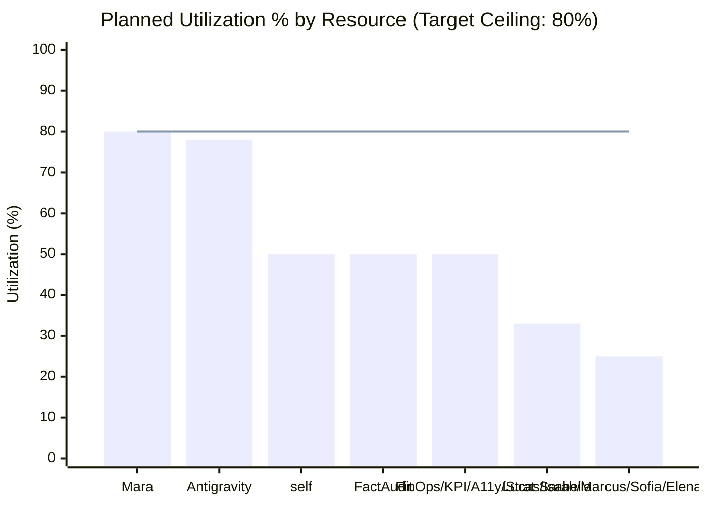

# Resource Utilization & Fair-Workload Board (`maramartins.com` Portfolio Optimization)

> **Status:** Draft Planning Artifact (**ON HOLD**  -  no code or Jira tickets executed until Mara Martins approves)  
> **Maintained By:** **Delivery & Focus Guardian** + **FinOps & Token Controller** · **Accountable Approver:** **Mara Martins (CEO / Owner)**  
> **Companion Docs:** [project_plan_prd.md](file:///Users/user/.gemini/antigravity/brain/a8ecca47-ef7c-44f0-a7c3-c24545ec0324/project_plan_prd.md) · [implementation_plan.md](file:///Users/user/.gemini/antigravity/brain/a8ecca47-ef7c-44f0-a7c3-c24545ec0324/implementation_plan.md)

---

## 1. Why a Workload Fairness & Utilization Board?
Even in a Human + AI team, unbalanced delegation creates bottlenecks, context overload, higher token waste, and burnout for the Human Owner ahead of **November 23, 2026**. This board enforces four operational rules:
1. **Capacity Ceilings & Redline Alerts:** Every resource (human and AI) has a defined **Phase Capacity Cap**. Any allocation `> 80%` triggers automatic load balancing before execution starts.
   - `🟢 Optimal (≤ 75%)` · `🟡 Near Ceiling (76–90%)` · `🔴 Overallocated (> 90%  -  Must Rebalance)`
2. **Human Bandwidth Protection:** Mara Martins's review/audit load is capped so **Nov 23 interview preparation** always stays protected (**Prep-Priority Override**).
3. **No Single-Agent Bottlenecks:** Heavy build and QA tasks are split cleanly across specialist agents (`self`, `Sofia`, `Isabella`, `Marcus`, `Lucas`, `WCAG Auditor`, `Fact Auditor`) rather than piling onto Antigravity alone.
4. **Idle vs. Active Visibility:** Every agent tracks **Active Work Time** separately from **Idle / Human-Wait Time** and **Token Load** so no resource is blamed for wait states or starved of context.

---

## 2. Team Capacity & Allocation Matrix (Phases 0–3)

*Note: AI agent "Capacity Cap" represents healthy context/session throughput per ~10-day sprint (~4.0 hrs max active per agent, or ≤ 2.0 hrs/phase) to keep prompts crisp, modular, and token-efficient.*

### A. Human Resources
| Resource | Phase 0 (Plan) | Phase 1 (MVP) | Phase 2 (Audit) | Phase 3 (Launch) | Total Est. Hrs | Sprint Cap | Utilization | Status & Fairness Guard |
|---|---|---|---|---|---|---|---|---|
| **Mara Martins** *(CEO / Owner)* | 1.75h | 1.50h | 4.50h *(pausable)* | 2.25h | **10.00h** *(range 9.75–12.25h)* | 12.50h *(pre-Nov 23 safe max)* | **80%** | 🟡 **Watch**  -  Phase 2 is heaviest; Prep-Priority Override pauses Phase 2 anytime |
| **Peer / Recruiter Reviewer** *(Optional)* | 0h | 0h | 0h | 0.50h | **0.50h** | 1.00h | **50%** | 🟢 Optimal  -  Single 15–30 min async/live UX review |

### B. IDE Subagents (Session Execution Layer)
| Resource | Phase 0 | Phase 1 | Phase 2 | Phase 3 | Total Active | Idle / Wait | Sprint Cap | Utilization | Status & Rebalancing Rule |
|---|---|---|---|---|---|---|---|---|---|
| **Antigravity** *(PM & Eng Lead)* | 1.00h | 1.00h | 0.50h | 1.00h | **3.50h** | ~2.00h | 4.50h | **78%** | 🟡 **Balanced**  -  Delegates React UI coding to `self` so Antigravity stays focused on orchestration & review |
| **`self` / custom** *(Parallel Dev)* | 0h | 1.00h | 0.25h | 0.25h | **1.50h** | 0h | 3.00h | **50%** | 🟢 Optimal  -  Absorbs isolated component builds (`/career`, `/interview`, `/brief`) |
| **`image-generator`** | 0.25h | 0h | 0h | 0h | **0.25h** | 0h | 1.00h | **25%** | 🟢 Optimal  -  Completed 4 mockups in Phase 0; idle unless new Case Study visuals needed (P2) |
| **`research`** | 0.15h | 0h | 0.25h | 0h | **0.40h** | 0h | 1.50h | **27%** | 🟢 Optimal  -  Handles read-only CV/LinkedIn & codebase sweeps |
| **`browser`** *(or local Lucas fallback)* | 0h | 0.25h | 0h | 0.25h | **0.50h** | 0h | 1.50h | **33%** | 🟢 Optimal  -  Runs `1440×900` & `1920×1080` zero-scroll checks |

### C. Existing Repo Agents Fleet (`agents/*.py` & `/dashboard`)
| Resource | Phase 0 | Phase 1 | Phase 2 | Phase 3 | Total Active | Sprint Cap | Utilization | Status & Fairness Guard |
|---|---|---|---|---|---|---|---|---|
| **Sarah** *(Jira PM  -  `jira_pm_agent.py`)* | 0h *(Hold)* | 0.10h | 0.05h | 0.10h | **0.25h** | 1.00h | **25%** | 🟢 Optimal  -  Only syncs after Mara Martins approves tickets |
| **Orchestrator** *(`orchestrator.py`)* | 0h | 0.05h | 0.05h | 0.15h | **0.25h** | 1.00h | **25%** | 🟢 Optimal  -  Dispatches QA sweep cleanly |
| **Marcus** *(Security  -  `security_analyst.py`)* | 0h | 0.05h | 0.10h | 0.10h | **0.25h** | 1.00h | **25%** | 🟢 Optimal  -  Focuses on `.gitignore` & secret/auth gates |
| **Elena** *(Loc Lead / Compliance  -  `loc_lead_expert.py`)* | 0h | 0h | 0.15h | 0.10h | **0.25h** | 1.00h | **25%** | 🟢 Optimal  -  GDPR/i18n check (`pt-PT` stays P2 so Elena isn't overloaded in Phase 1) |
| **Sofia** *(LQC  -  `lqc_engine.py`)* | 0h | 0.10h | 0.05h | 0.10h | **0.25h** | 1.00h | **25%** | 🟢 Optimal  -  Enforces `placeholder: true` production block |
| **Isabella + David** *(LQA & `en-US`)* *(Tiago P2)* | 0h | 0h | 0.25h | 0.25h | **0.50h** | 1.50h | **33%** | 🟢 Optimal  -  Tiago (`pt-PT`) rests at 0% until P2 |
| **Lucas** *(QA Tester  -  `tester_agent.py`)* | 0h | 0.20h | 0h | 0.30h | **0.50h** | 1.50h | **33%** | 🟢 Optimal  -  Runs route & regression checks |
| **Visual Auditor** *(`visual_auditor.py`)* | 0h | 0.15h | 0h | 0.10h | **0.25h** | 1.00h | **25%** | 🟢 Optimal  -  Checks Stellar dark-theme parity |
| **Julia** *(GTM  -  `gtm_strategy_agent.py`)* | 0h | 0h | 0h | 0.25h | **0.25h** | 1.00h | **25%** | 🟢 Optimal  -  Reviews `/gtm` & positioning alignment in Phase 3 |

### D. Proposed / Activated Specialist Roles (Gap Closure)
| Resource | Phase 0 | Phase 1 | Phase 2 | Phase 3 | Total Active | Sprint Cap | Utilization | Status & Fairness Guard |
|---|---|---|---|---|---|---|---|---|
| **Fact & Evidence Auditor** *(NEW)* | 0h | 0.15h *(test)* | 0.60h *(audit)* | 0h | **0.75h** | 1.50h | **50%** | 🟢 Optimal  -  Heavy lift isolated to Phase 2 (`CV ↔ LinkedIn ↔ Site`) |
| **Strategy & Style Advisors** *(Activated)* | 0h | 0h | 0.25h | 0.25h | **0.50h** | 1.00h | **50%** | 🟢 Optimal  -  Reviews copy & playbook before M3 |
| **FinOps & Token Controller** *(NEW)* | 0.10h | 0.10h | 0.15h | 0.15h | **0.50h** | 1.00h | **50%** | 🟢 Optimal  -  5–10 min ledger updates per phase |
| **WCAG 2.1 AA Auditor** *(NEW)* | 0h | 0.25h | 0h | 0.25h | **0.50h** | 1.00h | **50%** | 🟢 Optimal  -  Checks dark glass contrast & keyboard shortcuts |
| **Analytics & Telemetry Eng** *(NEW)* | 0h | 0h | 0h | 0.50h | **0.50h** | 1.00h | **50%** | 🟢 Optimal  -  Wires UTM, GA4/PostHog & `/dashboard` feed |
| **KPI & Metrics Steward** *(NEW)* | 0.10h | 0h | 0h | 0.40h | **0.50h** | 1.00h | **50%** | 🟢 Optimal  -  Validates KPI design & leads Pre-Close Metrics Revision |
| **IP Counsel** *(Activated)* | 0h | 0h | 0.25h | 0h | **0.25h** | 1.00h | **25%** | 🟢 Optimal  -  Single fair-use logo review in Phase 2 |
| **Delivery & Focus Guardian** *(NEW)* | 0.05h | 0.05h | 0.05h | 0.10h | **0.25h** | 1.00h | **25%** | 🟢 Optimal  -  Milestone start/end checks & override triggers |

---

## 3. Load Distribution Snapshot (Fairness Check)

**Fairness & Rebalancing Conclusions:**
- **No agent exceeds 80% capacity.** All repo QA agents sit cleanly at **25–50%**, avoiding overloaded multi-hat assignments.
- **Top 2 Watch Items (Yellow  -  78–80%):**
  1. **Mara Martins (80%  -  Phase 2 CV/Evidence heavy):** Protected by the **Prep-Priority Override** - if Nov 23 prep needs more time, Antigravity pauses Phase 2 immediately and handles non-evidence scaffolding while Mara preps.
  2. **Antigravity (78%):** Protected by delegating React component authoring to **`self`** subagents and QA sweeps to **`Orchestrator`** rather than running everything in one thread.
- **Resting Resources (Fair Rotation):** **Tiago (`pt-PT`)** stays at **0%** until P2 globalization; **`image-generator`** rests after Phase 0 mockups.

---

## 4. Integration into `/dashboard` (Two-Stage Rollout  -  Option A)
Because IDE token/session metrics do not stream second-by-second, `/dashboard` ([Dashboard.jsx](file:///Users/user/Documents/github/portfolio-builder/frontend/src/pages/Dashboard.jsx)) uses a **checkpoint-synced** rollout inside the existing `gov_auth_key`-gated Governance HQ:

1. **Stage 1  -  Phase 1 MVP (~30 min build, `REQ-5`):**
   - Lightweight **"Resource Utilization & Schedule"** card reading from `src/data/resourceUtilization.json` (synced with `docs/content/project_ledger.md` at every session checkpoint by **FinOps & Focus Guardian**).
   - Displays: `Resource` · `Phase Schedule` · `Est. vs. Actual Hrs` · `Capacity %` (`🟢/🟡/🔴` vs. 80% ceiling) · `Active / Resting / Paused` status.
2. **Stage 2  -  Phase 3 Full Telemetry (`REQ-9`):**
   - Expands with `Idle / Wait Hrs`, `Tokens & Token $ Burn`, live `orchestrator.py` QA results, UTM-filtered GA4/PostHog funnel signals, and the **Pre-Close Fair-Review Trigger** before sprint close.
